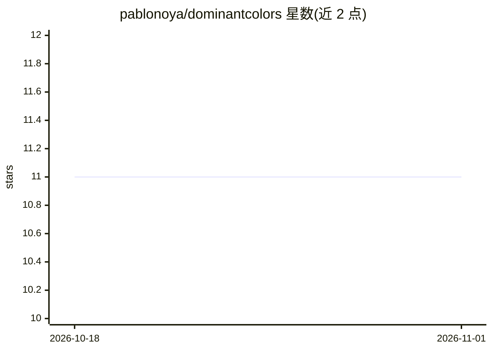

# pablonoya/dominantcolors

⭐ 11 · Python · GPL-3.0 · 推送 2026-02-02 · [GitHub](https://github.com/pablonoya/dominantcolors) · 个人维护

**用 K-means 从图像提取主色并调整对比度的 CLI 工具**

输入图像路径，通过 K-means 聚类提取主色，返回两个十六进制颜色值：最主导色作为背景，并选出最佳候选色作为前景，必要时调整其对比度以保证可读性。作者为个人 AwesomeWM 配置中的媒体播放器部件开发此工具。以 CLI 形式提供，支持通过 uv tool 或 pipx 从 GitHub 源码安装。

## 筛选速览

| 维度 | 判定 | 备注 |
|---|---|---|
| AI 角色 | `ai-native` | 本体是模型或模型工具 |
| 许可风险 | `viral` | GPL-3.0 |
| 部署形态 | `None` |  |
| 模型依赖 | — | README 未给出锁定关系 |
| 硬件要求 | — | 无带数字的原话,不猜 |
| 安装摩擦 | `low` | 无编译、无系统依赖或容器化 |
| 成熟度 | — | 结构信号不足 |

## 能力要点

- K-means 聚类提取图像主色
- 输出背景色与前景色两个十六进制值，自动调整对比度
- CLI 形式，接收图像路径作为输入

## 适用场景

- 为桌面部件（如媒体播放器）自动生成背景/前景配色
- 从图片快速取得可读性达标的配色方案

## 场景标签

`图像视频处理` · 领域:感知与多模态

## 证据(README 行号)

> L3: Gets the dominant colors from an image to use the most dominant one as background and the best candidate as foregrou
> L5: It was created for the media player widget on my AwesomeWM config.

## 星数曲线

2026-10-18 11 → 2026-11-01 11（+0）

---
*卡片 v1 · prompt 1.4 · 生成 2026-11-01 · 置信度 mid · 依据 README sha `7a99fb19cdf0` · [字段定义](../../DATASET.md)*
