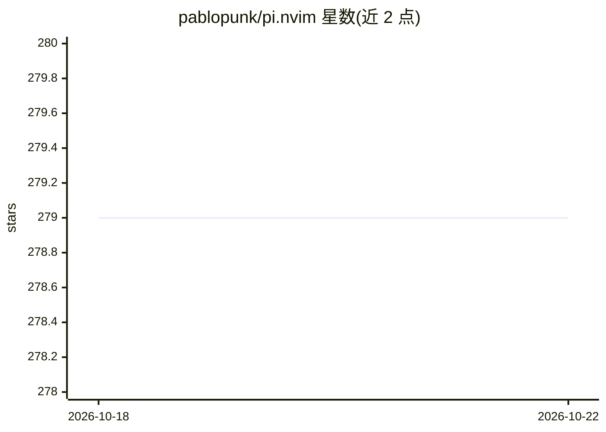

# pablopunk/pi.nvim

⭐ 280 · Lua · MIT · 推送 2026-10-12 · [GitHub](https://github.com/pablopunk/pi.nvim) · 个人维护

**Neovim 插件：在编辑器内调用 pi CLI 编程 agent**

pi.nvim 是连接 Neovim 与命令行 AI agent pi 的插件，通过 :PiAsk / :PiAskSelection 等命令将当前缓冲区、选区、cwd 及可选诊断作为上下文发送给 pi 执行，异步运行不阻塞编辑，完成后重载被 pi 修改的缓冲区，未保存内容优先于磁盘文件。可配置 provider、model、thinking 级别、启用工具集、上下文裁剪与 session 保存，无默认键位。要求 Neovim 0.10+ 且全局安装 pi，支持 lazy.nvim / packer / mini.deps 三种插件管理器安装，另暴露 get_cmd()/run() API。

## 筛选速览

| 维度 | 判定 | 备注 |
|---|---|---|
| AI 角色 | `ai-ecosystem` | LLM/agent 周边工具 |
| 许可风险 | `permissive` | MIT |
| 部署形态 | `None` |  |
| 模型依赖 | — | README 未给出锁定关系 |
| 硬件要求 | — | 无带数字的原话,不猜 |
| 安装摩擦 | `low` | 无编译、无系统依赖或容器化 |
| 成熟度 | — | 结构信号不足 |

## 能力要点

- 发送缓冲区/选区/诊断作为上下文，未保存内容优先于磁盘
- 异步执行，成功后自动重载被 pi 修改的缓冲区
- 可配置 provider、model、thinking 级别、工具集与上下文裁剪
- 暴露 get_cmd()/run() 编程 API

## 适用场景

- 在 Neovim 里让 AI agent 直接读取并修改当前代码文件
- 对选中代码片段发起提问或修改
- 复用 pi CLI 的 provider/model 配置在编辑器内工作

## 场景标签

`编码 Agent` · 领域:编码与开发

## 证据(README 行号)

> L3: A Neovim plugin for interacting with pi - the minimal cli agent.
> L110: |`:PiAsk`|Normal|Prompt for input, sends it + current buffer as context|

## 星数曲线

2026-10-18 279 → 2026-10-22 279（+0）

---
*卡片 v1 · prompt 1.4 · 生成 2026-10-22 · 置信度 high · 依据 README sha `f00841592589` · [字段定义](../../DATASET.md)*
