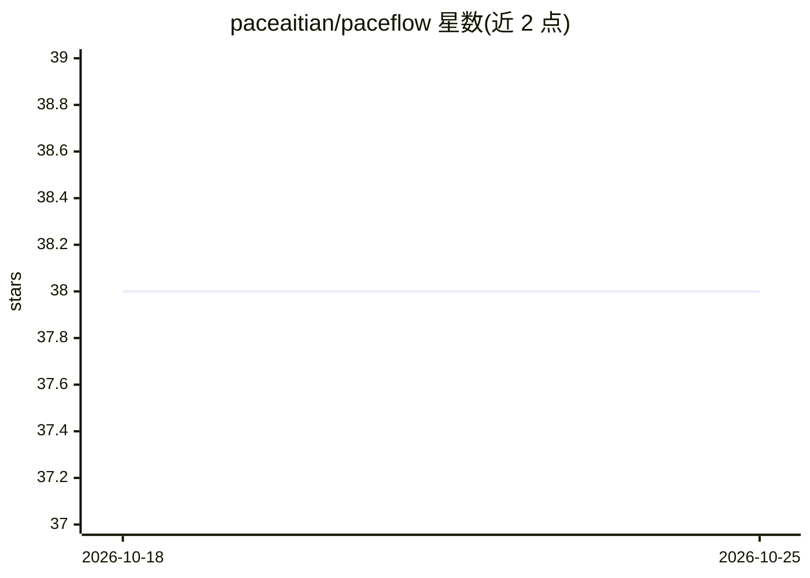

# paceaitian/paceflow

⭐ 38 · JavaScript · MIT · 推送 2026-08-17 · [GitHub](https://github.com/paceaitian/paceflow) · 个人维护 · 中文 README

**给长期编码 agent 的工作流强制与工程记忆层插件**

以 Claude Code 插件形式提供、也可装入 OpenAI Codex CLI 的工作流可靠性层。它在工具调用边界通过生命周期 hook 强制 Plan→Artifact→Check→Execute→Verify→Review 流程：代码写入前须有经用户批准的活动 CHG/HOTFIX，会话结束前须完成验证、评审与归档；任务状态持久化在模型上下文之外，并在会话启动、恢复与压缩时还原。记录工作由独立的 artifact-writer agent 承担。明确声明自身不是编码模型、缺陷检测器或测试/CI/评审的替代品。安装通过 Claude Code / Codex 插件市场命令完成，要求 Claude Code 2.1.218 或更新版本。

## 筛选速览

| 维度 | 判定 | 备注 |
|---|---|---|
| AI 角色 | `ai-ecosystem` | LLM/agent 周边工具 |
| 许可风险 | `permissive` | MIT |
| 部署形态 | `None` |  |
| 模型依赖 | locked-api |  |
| 硬件要求 | — | 无带数字的原话,不猜 |
| 安装摩擦 | `low` | 无编译、无系统依赖或容器化 |
| 成熟度 | `idea` | |

## 能力要点

- 12 类生命周期 hook 在工具边界执行确定性工作流门禁
- 任务状态持久化于模型上下文外，跨会话与上下文压缩还原
- PACE 生命周期含用户批准、验证、评审与归档等强制环节
- 同一插件目录可装入 Claude Code 与 Codex CLI（经 codex-adapter 与 MCP server）

## 适用场景

- 长会话编码任务中防止跳过计划批准、验证或评审
- 上下文压缩或新会话后恢复正在进行的变更状态
- 把变更、发现、修正等工程记录持久化为结构化工件（可选存入 Obsidian）

## 场景标签

`Agent 记忆` · 领域:Agent 开发

## 证据(README 行号)

> L9: > **Deterministic workflow enforcement and persistent engineering memory for long-running coding agents.**
> L25: PACEflow addresses these failures at the workflow layer. Instead of asking the model to remember every transition, 
> L43: The current implementation uses the host's lifecycle hooks (Claude Code hooks; Codex CLI hooks through a thin host 

## 星数曲线

2026-10-18 38 → 2026-10-25 38（+0）

---
*卡片 v1 · prompt 1.4 · 生成 2026-10-25 · 置信度 high · 依据 README sha `01076fad3505` · [字段定义](../../DATASET.md)*
