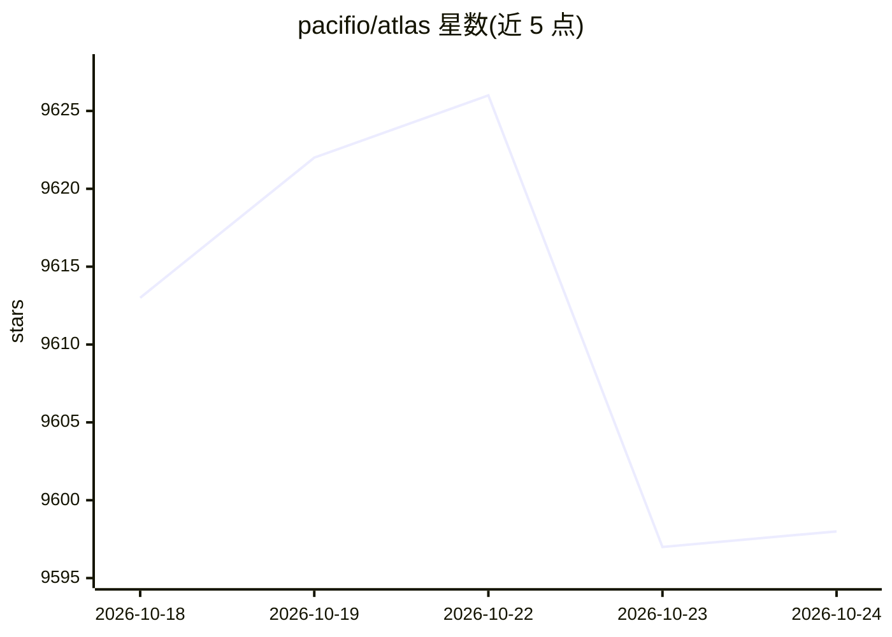

# pacifio/atlas

⭐ 9,598 · TypeScript · Apache-2.0 · 推送 2026-10-23 · [GitHub](https://github.com/pacifio/atlas) · [官网](https://www.tryatlas.cc/) · 组织维护

**面向编码代理的源码控制桌面应用：追踪并查询各代理的改动**

基于 Tauri 的桌面应用，定位为编码代理的源码控制工具。可并排运行 Claude Code、Codex、Atlas 原生代理及 ACP 注册表中的代理（Cursor、OpenCode、Kilo Code 等），共享同一代码库与共享记忆。核心机制是 checkpoint：提交自动关联到产生它的会话（提示词、工具调用、推理），链接可在 rebase/amend 后存活；会话记录写入本地 .atlas/sessions.db，密钥写入前被擦除。默认完全本地运行，无需账号。支持平台为 macOS 13+ 与 Windows 10+（x64），Linux 从源码构建但未经测试。除代理功能外还内置编辑器、git 图、终端、markdown 知识库、论文检索与浏览器。

## 筛选速览

| 维度 | 判定 | 备注 |
|---|---|---|
| AI 角色 | `ai-ecosystem` | LLM/agent 周边工具 |
| 许可风险 | `permissive` | Apache-2.0 |
| 部署形态 | `desktop` | 安装包/桌面程序 |
| 模型依赖 | — | README 未给出锁定关系 |
| 硬件要求 | — | 无带数字的原话,不猜 |
| 安装摩擦 | `low` | 无编译、无系统依赖或容器化 |
| 成熟度 | — | 结构信号不足 |

## 能力要点

- checkpoint 机制：提交自动关联产生它的代理会话（提示词/工具调用/推理），rebase/amend 后链接存活
- 并排运行 Claude Code、Codex、原生代理及 ACP 注册表代理，共享记忆与上下文
- 本地优先：会话记录、嵌入检索均在本机，密钥写入前擦除，无需账号即可工作
- 内置编辑器、git 提交图、终端、markdown 知识库、arXiv/Semantic Scholar 检索与浏览器

## 适用场景

- 同时使用多个编码代理时统一追踪谁改了什么以及为什么
- 事后查询某次提交对应的会话上下文与推理过程
- 跨代理延续任务上下文，避免换代理后从零开始

## 场景标签

 · 领域:开发者工具/AI 编码代理

## 证据(README 行号)

> L24: Atlas is source control for coding agents. Every agent run produces checkpoints: commits are linked back to the ses
> L26: Run Claude Code, Codex, Atlas's own agent, or anything from the ACP registry side by side against the same codebase
> L71: Claude Code and Codex run as external subprocesses over ACP, the most-used, most-tested path. Atlas Agent, the nati

## 星数曲线

2026-10-18 9,613 → 2026-10-24 9,598（-15）

---
*卡片 v1 · prompt 1.4 · 生成 2026-10-20 · 置信度 high · 依据 README sha `a7f651e48fef` · [字段定义](../../DATASET.md)*
