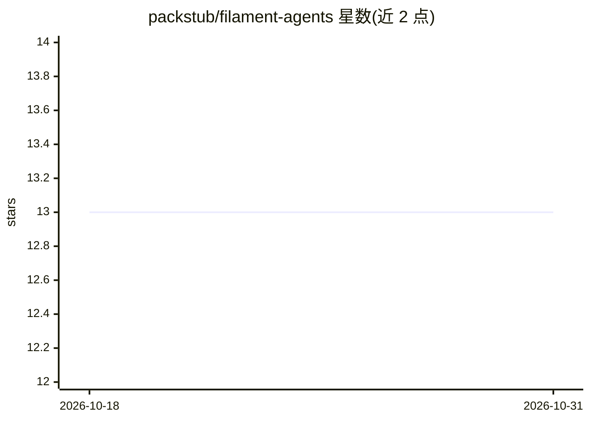

# packstub/filament-agents

⭐ 13 · PHP · MIT · 推送 2026-10-29 · [GitHub](https://github.com/packstub/filament-agents) · [官网](https://packstub.dev/plugins/filament-agents) · 组织维护

**为 Filament v5 面板提供内置 AI 助手与 MCP 服务器的 Laravel 插件**

基于 laravel/ai 与 laravel/mcp 构建的 Filament v5 面板插件：一次编写的工具同时服务面板内聊天与 Claude Code、Cursor 等 MCP 客户端，复用面板自身的权限体系；写操作在聊天中经 Approve/Reject 审批，答案可内嵌 Filament 实时表格与图表；支持按用户/工作区的 token 与次数预算、多租户、知识库引用与网络搜索白名单等。运行于 Anthropic、OpenAI、Gemini 或 xAI，其他 laravel/ai 供应商（含 Ollama）亦可使用，并支持 failover。面向使用 Filament 的 Laravel 开发者，通过 Composer 安装，需 PHP 8.4+、Laravel 13.x。

## 筛选速览

| 维度 | 判定 | 备注 |
|---|---|---|
| AI 角色 | `ai-ecosystem` | LLM/agent 周边工具 |
| 许可风险 | `permissive` | MIT |
| 部署形态 | `None` |  |
| 模型依赖 | local-ok | 支持本地模型 |
| 硬件要求 | — | 无带数字的原话,不猜 |
| 安装摩擦 | `low` | 无编译、无系统依赖或容器化 |
| 成熟度 | — | 结构信号不足 |

## 能力要点

- 一套工具同时服务面板聊天与任意 MCP 客户端，复用面板权限与 token 收窄
- 写操作在聊天中以 Approve/Reject 审批执行
- 答案内嵌资源实时表格与柱/折线/饼图，工具返回数据可绘图
- 按用户与工作区的回答数/token 预算及运营页管理
- 支持 Anthropic/OpenAI/Gemini/xAI 及其他 laravel/ai 供应商（含 Ollama），带 failover

## 适用场景

- 在 Filament 管理面板中加入带权限控制的 AI 问答助手
- 把面板工具经 MCP 暴露给 Claude Code、Cursor 等客户端使用
- 对 AI 写操作设置审批门槛并按工作区控制用量与成本

## 场景标签

`AI 助手` · 领域:对话与助手

## 证据(README 行号)

> L12: An in-panel AI assistant and an MCP server for your Filament v5 panel, built on laravel/ai and laravel/mcp. Write a
> L27: - **Your assistant, your prompt**: a scaffolded agent class on Anthropic, OpenAI, Gemini or xAI, with failover.
> L121: It runs on Anthropic, OpenAI, Gemini or xAI; any other laravel/ai provider, Ollama included, runs on its smartest 

## 星数曲线

2026-10-18 13 → 2026-10-31 13（+0）

---
*卡片 v1 · prompt 1.4 · 生成 2026-10-31 · 置信度 high · 依据 README sha `96bcb1b94e10` · [字段定义](../../DATASET.md)*
