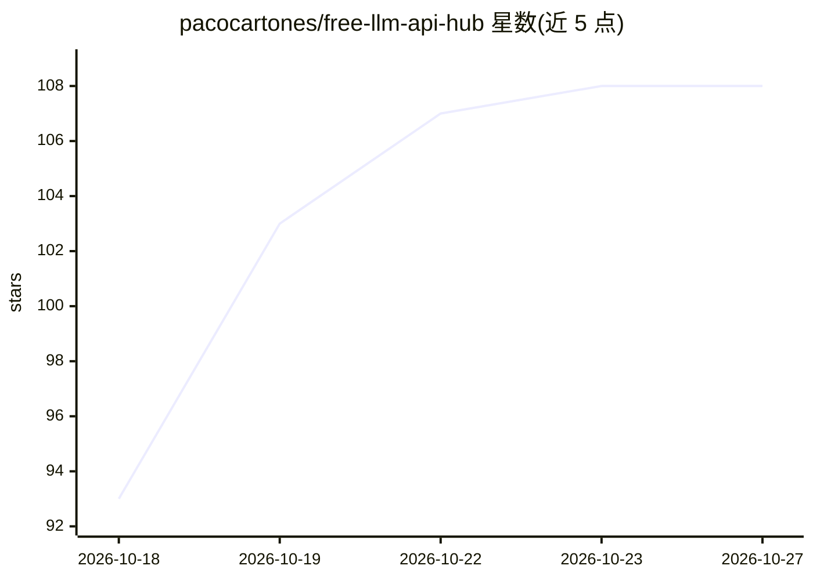

# pacocartones/free-llm-api-hub

⭐ 108 · JavaScript · MIT · 推送 2026-10-20 · [GitHub](https://github.com/pacocartones/free-llm-api-hub) · [官网](https://freellmapihub.com/) · 组织维护

**持续验证的免费 LLM API 数据集：供开发者选型免费模型 API**

社区维护的免费 LLM 及相邻模型 API（图像、语音、嵌入、rerank、OCR）开放数据集：每条条目标注验证日期并链接到提供商官方文档，未确认项标记 ⚠️；数据以 data/providers.json 为唯一事实源，经 schema 校验后生成 README、徽章与网站。新鲜度按 90 天 SLA 对最旧一次复验计算并随维护衰减。覆盖 68 个提供商，提供交互式浏览器与按需筛选集合（无信用卡、可商用、OpenAI 兼容等），并给出基于数据计算的前十榜单。项目声明独立维护、与任何提供商无关联。

## 筛选速览

| 维度 | 判定 | 备注 |
|---|---|---|
| AI 角色 | `ai-knowledge` | 知识聚合/清单类 |
| 许可风险 | `permissive` | MIT |
| 部署形态 | `None` |  |
| 模型依赖 | — | README 未给出锁定关系 |
| 硬件要求 | — | 无带数字的原话,不猜 |
| 安装摩擦 | `low` | 无编译、无系统依赖或容器化 |
| 成熟度 | — | 结构信号不足 |

## 能力要点

- 条目逐条标注验证日期并链接提供商官方文档，未确认项显式标记
- data/providers.json 为唯一事实源，README/徽章/网站均由其生成
- 按无信用卡、无手机验证、可商用、OpenAI 兼容等维度提供筛选集合
- 前十榜单由 67 个已验证提供商的数据计算生成，非手工排序

## 适用场景

- 原型开发前比较各免费 LLM API 的额度、限制与条款细节
- 筛选不需要信用卡或手机验证的免费 API
- 确认某免费层是否允许商用或仅为评估用途

## 场景标签

`精选清单` · 领域:学习与行业

## 证据(README 行号)

> L5: Free LLM APIs plus adjacent model APIs — image, speech, embeddings, rerank and OCR. Free tiers, trial credits and no
> L29: This project treats the list as a **maintained open dataset**, not a blog post:
> L35: - **The data is the source of truth.** `data/providers.json` is validated against a schema; this README, the badge 

## 星数曲线

2026-10-18 93 → 2026-10-27 108（+15）

---
*卡片 v1 · prompt 1.4 · 生成 2026-10-23 · 置信度 high · 依据 README sha `03951cd74cd4` · [字段定义](../../DATASET.md)*
