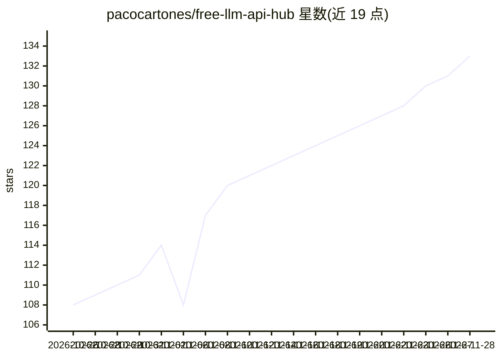

# pacocartones/free-llm-api-hub

⭐ 133 · JavaScript · MIT · 推送 2026-11-27 · [GitHub](https://github.com/pacocartones/free-llm-api-hub) · [官网](https://freellmapihub.com/) · 个人维护

**面向开发者的免费档 LLM API 持续核验数据集**

收录 96 家提供免费层、试用额度或零成本配额的 LLM 及相邻模型 API（语音、图像、嵌入、rerank、OCR）的数据集，每次核验标注日期并溯源至提供商官方文档，未能确认的条目予以标记。数据以 providers.json 机器可读格式发布，提供按需求筛选的交互式浏览器、评分排行与六问推荐流程，并附 API 端点可查询。维护方声明为社区独立维护，与所列提供商无关联；条目含 OpenAI 兼容性、是否需信用卡/手机验证、商用限制等字段。

## 筛选速览

| 维度 | 判定 | 备注 |
|---|---|---|
| AI 角色 | `ai-knowledge` | 知识聚合/清单类 |
| 许可风险 | `permissive` | MIT |
| 部署形态 | `None` |  |
| 模型依赖 | — | README 未给出锁定关系 |
| 硬件要求 | — | 无带数字的原话,不猜 |
| 安装摩擦 | `low` | 无编译、无系统依赖或容器化 |
| 成熟度 | — | 结构信号不足 |

## 能力要点

- 96 家提供商条目均标注核验日期并溯源至官方文档
- 数据以 data/providers.json 机器可读格式发布，附公开 API 端点
- 按需求组织的集合：免卡、免手机验证、免账户、可商用、OpenAI 兼容等
- 含 'Not free' 章节，列明 OpenAI/Anthropic 等无免费 API 档的事实

## 适用场景

- 为副业项目找不要信用卡的免费 LLM API
- 挑一个 OpenAI 兼容的免费端点替换 base_url
- 查某家提供商的免费层是否限商用或需手机验证

## 场景标签

`精选清单` · 领域:学习与行业

## 证据(README 行号)

> L7: A continuously-verified dataset of free LLM & AI-model APIs.
> L49: > Independent, community-maintained dataset — **not affiliated with, endorsed by, or sponsored by any provider belo
> L92: Primarily **free LLM (text) APIs** — plus the adjacent model APIs a builder reaches for next: **image generation, s

## 星数曲线

2026-10-26 108 → 2026-11-28 133（+25）

---
*卡片 v1 · prompt 1.4 · 生成 2026-11-28 · 置信度 high · 依据 README sha `e947797add6d` · [字段定义](../../DATASET.md)*
