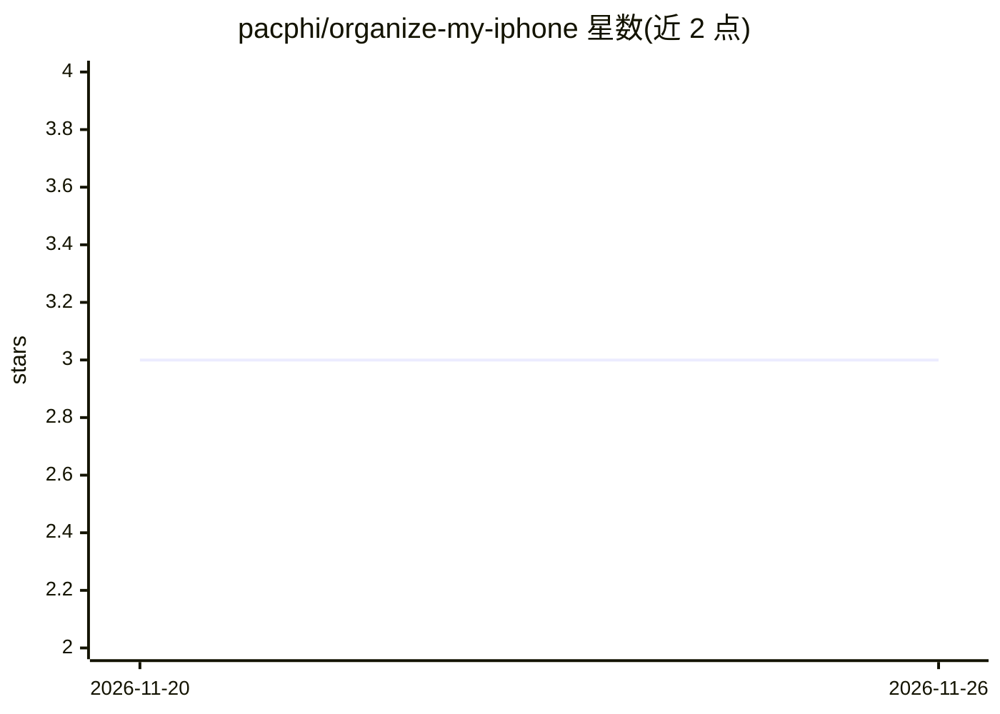

# pacphi/organize-my-iphone

⭐ 3 · Swift · 推送 2026-11-16 · [GitHub](https://github.com/pacphi/organize-my-iphone) · 个人维护

**Mac 上扫描 USB 连接的 iPhone 应用并生成整理后的主屏幕方案**

面向 macOS 用户的命令行工具，通过 Apple Configurator 的 cfgutil 读取 USB 连接 iPhone 上的应用列表与图标布局，结合 iTunes Lookup API 补充应用类别信息，用本地模型（Ollama 或 Apple 端侧模型）对应用分类，生成 12 种整理方案（分类页、文件夹、字母序、使用频率、拇指可达等）并以 HTML 页面预览；确认后写入手机，可随时 restore 恢复备份。写入依赖 cfgutil set-icon-layout，在不同 iOS 版本上行为可能不同。需 macOS 15+、Xcode 26+ 与 Apple Configurator。

## 筛选速览

| 维度 | 判定 | 备注 |
|---|---|---|
| AI 角色 | `ai-native` | 本体是模型或模型工具 |
| 许可风险 | `none` | — |
| 部署形态 | `None` |  |
| 模型依赖 | local-ok | 支持本地模型 |
| 硬件要求 | — | 无带数字的原话,不猜 |
| 安装摩擦 | `low` | 无编译、无系统依赖或容器化 |
| 成熟度 | `idea` | |

## 能力要点

- 12 种主屏幕整理方案（分类、字母、使用频率、彩虹色、拇指可达等）
- 本地模型分类，不调用云端模型，应用列表数据保留在 Mac 上
- 写入前自动备份，支持 --dry-run 与 restore 恢复
- make demo 提供假 iPhone 模拟全流程

## 适用场景

- 给 USB 连接的 iPhone 重新规划主屏幕布局
- 按使用频率或时段整理上百个应用
- 在假 iPhone 上先预览布局效果再实际应用

## 场景标签

`工作流自动化` · 领域:效率与自动化

## 证据(README 行号)

> L11: A command-line tool for macOS that reads the apps on a connected iPhone, sorts them into categories with a model th
> L40: 3. **Classify.** Built-in rules place the apps they are sure about (Apple's own, and apps whose store genre settles

## 星数曲线

2026-11-20 3 → 2026-11-26 3（+0）

---
*卡片 v1 · prompt 1.4 · 生成 2026-11-21 · 置信度 high · 依据 README sha `f54252f13ea6` · [字段定义](../../DATASET.md)*
