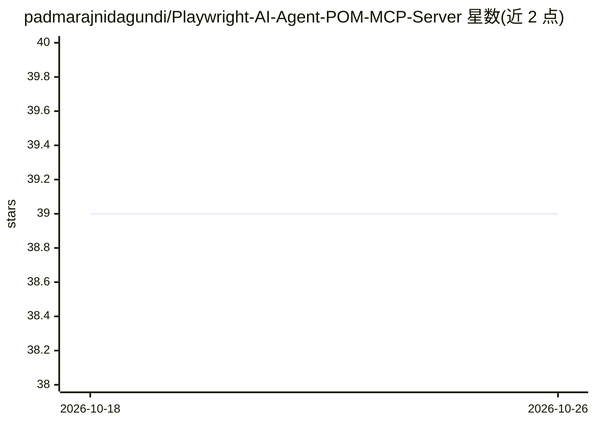

# padmarajnidagundi/Playwright-AI-Agent-POM-MCP-Server

⭐ 39 · TypeScript · 推送 2026-10-25 · [GitHub](https://github.com/padmarajnidagundi/Playwright-AI-Agent-POM-MCP-Server) · 个人维护

**Playwright 测试框架 + MCP 服务器：让 AI 客户端运行与读取测试**

基于 TypeScript/Node.js 20+ 的 Playwright 测试自动化框架，采用 Page Object Model 架构。核心包含：符合 Model Context Protocol 的 JSON-RPC 服务器（mcp-server.ts），暴露 run_tests、get_test_results、list_test_files 三个工具，供 GitHub Copilot、Claude Desktop 等 AI 客户端调用；自定义 AI Reporter 输出含 aiHint 修复建议的结构化 JSON；抽象 BasePage 类提供指数退避重试、软断言、性能计时；覆盖 14 类测试（安全/无障碍/i18n/混沌等）。提供 Docker 与 npm 安装方式，需 npx playwright install 安装浏览器依赖。

## 筛选速览

| 维度 | 判定 | 备注 |
|---|---|---|
| AI 角色 | `ai-ecosystem` | LLM/agent 周边工具 |
| 许可风险 | `none` | — |
| 部署形态 | `self-host` | docker 或自建部署 |
| 模型依赖 | — | README 未给出锁定关系 |
| 硬件要求 | — | 无带数字的原话,不猜 |
| 安装摩擦 | `low` | 无编译、无系统依赖或容器化 |
| 成熟度 | — | 结构信号不足 |

## 能力要点

- MCP 服务器暴露 3 个 JSON-RPC 工具供 AI 客户端运行测试与读取结果
- AI Reporter 生成含 per-test aiHint 修复建议的结构化 JSON
- BasePage 抽象类：指数退避重试、软断言、稳定元素等待、性能计时
- 14 类测试类别，覆盖安全、无障碍、i18n、混沌工程

## 适用场景

- 让 Claude Desktop 或 GitHub Copilot 通过 MCP 直接执行测试套件
- 搭建含 API 预认证、失败自动 trace 的 Playwright 测试基座
- 以结构化 JSON 报告对接 LLM 做 AI 辅助调试

## 场景标签

`浏览器自动化` · 领域:效率与自动化

## 证据(README 行号)

> L29: |🧠 **MCP Server**|A standards-compliant Model Context Protocol server (`mcp-server.ts`) that lets any AI assistant 
> L68: |`mcp-server.ts`|MCP-compliant JSON-RPC server exposing `run_tests`, `get_test_results`, `list_test_files`|
> L155: The `mcp-server.ts` implements the **Model Context Protocol** so that any compatible AI client (GitHub Copilot, Cl

## 星数曲线

2026-10-18 39 → 2026-10-26 39（+0）

---
*卡片 v1 · prompt 1.4 · 生成 2026-10-25 · 置信度 high · 依据 README sha `740597096d1c` · [字段定义](../../DATASET.md)*
