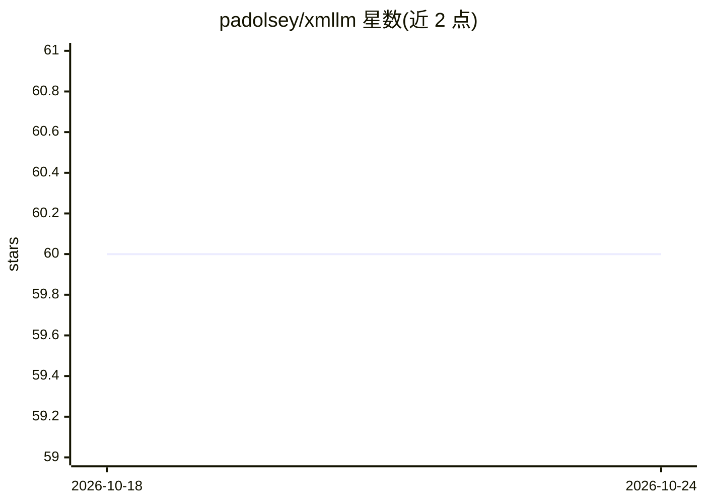

# padolsey/xmllm

⭐ 60 · JavaScript · 推送 2026-06-25 · [GitHub](https://github.com/padolsey/xmllm) · [官网](https://xmllm.j11y.io) · 个人维护

**JS 库：用 XML 从 LLM 输出提取结构化数据**

JavaScript 实用库，通过让 LLM 以 XML 形式响应并经宽松的流式 HTML 解析器（htmlparser2）提取数据，按用户定义的 schema 转换为结构化数据，支持流式实时反射。提供 simple/stream/pipeline 三层 API，可自定义 provider，开箱配置 Anthropic、OpenAI、Together.ai、Perplexity、OpenRouter 等，支持回退模型。另有实验性 Idio 解析语法。作者声明仍处实验阶段（experimental）。

## 筛选速览

| 维度 | 判定 | 备注 |
|---|---|---|
| AI 角色 | `ai-ecosystem` | LLM/agent 周边工具 |
| 许可风险 | `none` | — |
| 部署形态 | `library` | 以包/库形式分发 |
| 模型依赖 | locked-api |  |
| 硬件要求 | — | 无带数字的原话,不猜 |
| 安装摩擦 | `low` | 无编译、无系统依赖或容器化 |
| 成熟度 | `idea` | |

## 能力要点

- schema 驱动，LLM 输出 XML 经宽松 HTML 解析器转为结构化数据
- 流式提取，实时或完成后取值
- provider 无关，可自定义 provider 与回退模型
- 实验性 Idio 替代解析语法，可处理含标记的输出

## 适用场景

- 在 JS 应用中从 LLM 获取 schema 化的结构化数据
- 流式场景下渐进式填充 UI（如生成器界面）
- 程序化地用 LLM 做情感分析等文本提取任务

## 场景标签

 · 领域:LLM 基础设施/结构化输出

## 证据(README 行号)

> L3: xmllm is a JS utility that makes it easy to get structured data from LLMs, using a boring, time-tested, semantically
> L65: xmllm is able to be run against most conceivable endpoints since you can define custom providers. We define some pr
> L129: Once the stream starts coming in, xmllm uses a lenient streaming HTML parser (htmlparser2) to extract the data the

## 星数曲线

2026-10-18 60 → 2026-10-24 60（+0）

---
*卡片 v1 · prompt 1.4 · 生成 2026-10-24 · 置信度 high · 依据 README sha `bc5e80a5401d` · [字段定义](../../DATASET.md)*
