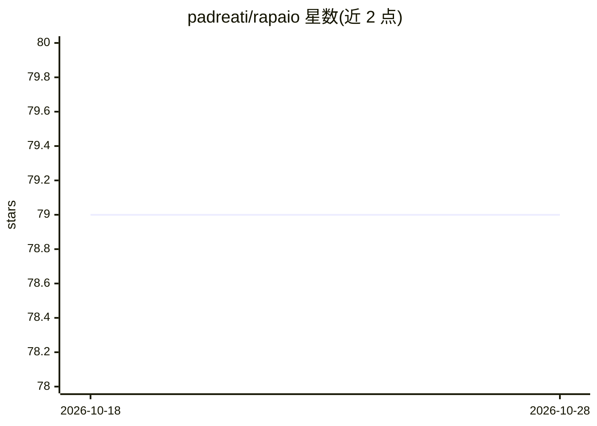

# padreati/rapaio

⭐ 79 · Java · NOASSERTION · 推送 2026-10-18 · [GitHub](https://github.com/padreati/rapaio) · 个人维护

**纯 Java 编写的统计、数据挖掘与机器学习库**

用 Java 实现的统计、数据挖掘与机器学习工具库，算法覆盖朴素贝叶斯、逻辑回归、决策树、随机森林、AdaBoost、梯度提升树、SVM、RVM、线性/岭回归、PCA 与 KMeans，另含分布与假设检验等统计工具及图形与线性代数组件。面向 Java 开发者，通过 Maven Central 以依赖形式引入；亦提供 Jupyter 内核，可在 jupyter/jupyter-lab 笔记本中交互使用。文档以 Jupyter 笔记本形式托管于 github pages 与 rapaio-book 仓库。

## 筛选速览

| 维度 | 判定 | 备注 |
|---|---|---|
| AI 角色 | `ai-native` | 本体是模型或模型工具 |
| 许可风险 | `none` | NOASSERTION |
| 部署形态 | `None` |  |
| 模型依赖 | — | README 未给出锁定关系 |
| 硬件要求 | — | 无带数字的原话,不猜 |
| 安装摩擦 | `low` | 无编译、无系统依赖或容器化 |
| 成熟度 | — | 结构信号不足 |

## 能力要点

- 纯 Java 实现的机器学习算法集（随机森林、GBM、SVM、PCA、KMeans 等）
- 核心统计工具、常见分布与假设检验
- 提供图形工具与线性代数组件
- 支持通过 rapaio-jupyter-kernel 在 Jupyter 中交互使用

## 适用场景

- 在 Java 项目中直接引入机器学习与统计算法
- 在 Jupyter 笔记本中做数据挖掘实验与文档化探索

## 场景标签

 · 领域:机器学习/统计计算库

## 证据(README 行号)

> L23: Rapaio is a rich collection of data mining, statistics and machine learning tools written completely
> L29: implemented algorithms and features includes: core statistical tools, common distributions and hypothesis testing, 

## 星数曲线

2026-10-18 79 → 2026-10-28 79（+0）

---
*卡片 v1 · prompt 1.4 · 生成 2026-10-24 · 置信度 high · 依据 README sha `9ea4a9d4e9df` · [字段定义](../../DATASET.md)*
