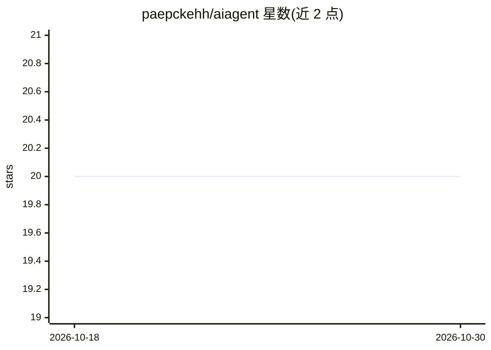

# paepckehh/aiagent

⭐ 20 · Go · BSD-3-Clause · 推送 2026-10-06 · [GitHub](https://github.com/paepckehh/aiagent) · [官网](https://paepcke.de/aiagent) · 个人维护

**用 OpenAI GPT 处理订阅服务邮箱请求的 Go 库**

Go 语言库（含示例 CLI 应用），面向订阅服务商：自动处理邮箱中的客户请求（如退订）。核心机制包括本地优先的预处理与过滤——校验发件人地址 RFC 合规性、过滤不支持的语言（支持 84 种语言）、隔离或去除正文中的额外地址与 URL，以降低 OpenAI API 费用并防止对本地数据库的 DoS 攻击。需自备 OpenAI API token，作为库需按业务定制；Ollama 离线处理在 dev 分支。

## 筛选速览

| 维度 | 判定 | 备注 |
|---|---|---|
| AI 角色 | `ai-native` | 本体是模型或模型工具 |
| 许可风险 | `permissive` | BSD-3-Clause |
| 部署形态 | `library` | 以包/库形式分发 |
| 模型依赖 | local-ok | 支持本地模型 |
| 硬件要求 | — | 无带数字的原话,不猜 |
| 安装摩擦 | `low` | 无编译、无系统依赖或容器化 |
| 成熟度 | `idea` | |

## 能力要点

- 本地优先预处理：地址校验、语言过滤、正文清洗，节省 token 开销
- 支持 84 种语言的请求处理
- 提供 go install 安装的示例 CLI 与预编译 release
- Ollama 离线处理位于 ollama-dev 分支（WIP）

## 适用场景

- 订阅服务商自动处理退订类邮件请求
- 在调用付费 API 前过滤垃圾邮件与不相关语言邮件
- 降低 OpenAI token 消耗并满足欧盟 GDPR 要求

## 场景标签

`工作流自动化` · 领域:效率与自动化

## 证据(README 行号)

> L11: Manage your subscription service mailbox (e.g. cancel-requests) via AI (OpenAI /
> L19: - Protect your OpenAI-API Key Budget [$US] with extensive local-first

## 星数曲线

2026-10-18 20 → 2026-10-30 20（+0）

---
*卡片 v1 · prompt 1.4 · 生成 2026-10-28 · 置信度 high · 依据 README sha `eadfcd0603ff` · [字段定义](../../DATASET.md)*
