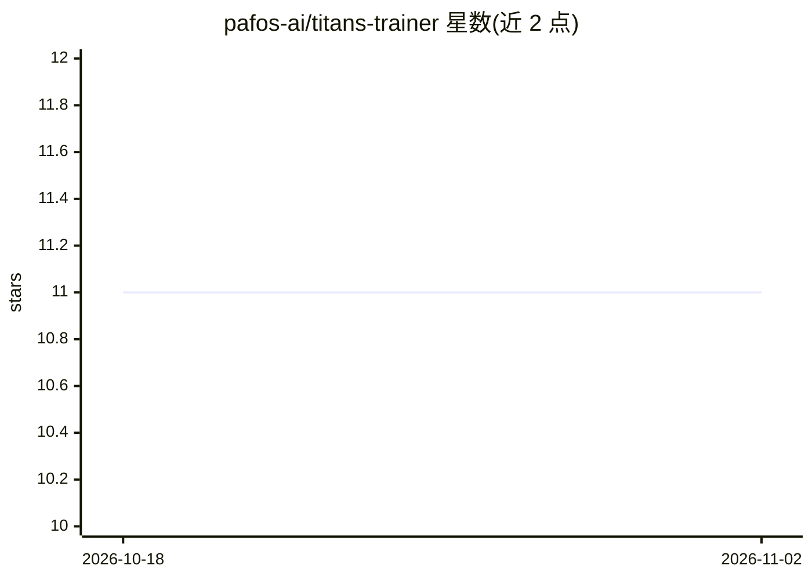

# pafos-ai/titans-trainer

⭐ 11 · Python · MIT · 推送 2026-03-27 · [GitHub](https://github.com/pafos-ai/titans-trainer) · 个人维护

**HuggingFace 风格的 TITANS 架构训练框架，5 行代码训练模型**

基于 TITANS 论文（Behrouz et al., Google Research）的社区独立实现，提供 MAC 变体的神经网络长期记忆模型，配套 HuggingFace 风格训练器：配置预设（small/base/large）、混合精度、多 GPU、W&B 日志、断点续训、回调机制与 save/load_pretrained。支持 GPT 式自回归、BERT 式 MLM 与连续特征（时序/传感）三类训练范式，以及基于 surprise 分数的异常检测。README 含 TinyShakespeare 上与 nanoGPT 的对照基准，并称其驱动基因组基础模型 BioTitan。需 PyTorch ≥2.1。

## 筛选速览

| 维度 | 判定 | 备注 |
|---|---|---|
| AI 角色 | `ai-ecosystem` | LLM/agent 周边工具 |
| 许可风险 | `permissive` | MIT |
| 部署形态 | `library` | 以包/库形式分发 |
| 模型依赖 | — | README 未给出锁定关系 |
| 硬件要求 | — | 无带数字的原话,不猜 |
| 安装摩擦 | `low` | 无编译、无系统依赖或容器化 |
| 成熟度 | — | 结构信号不足 |

## 能力要点

- 神经记忆在前向传播中经内层梯度下降更新权重，实现测试时学习
- HuggingFace 风格 Trainer：AMP、多 GPU、W&B 日志、断点续训、回调
- 支持自回归 / MLM / 连续特征三种训练范式
- 基于 surprise 分数的异常检测与分布外检测 API

## 适用场景

- 在自有数据上训练 TITANS 架构的语言模型
- 时序或传感数据上做测试时适应与异常检测
- 复现论文 toy 基准或对比 TITANS 与 vanilla transformer

## 场景标签

`模型训练` · 领域:训练与推理

## 证据(README 行号)

> L3: **Train TITANS models in 5 lines.** HuggingFace-style trainer for the TITANS architecture (Behrouz et al., Google Re
> L20: lucidrains/titans-pytorch provides an excellent implementation of the TITANS architecture with all three variants (
> L25: |Training framework|❌|✅ HuggingFace-style Trainer|

## 星数曲线

2026-10-18 11 → 2026-11-02 11（+0）

---
*卡片 v1 · prompt 1.4 · 生成 2026-11-01 · 置信度 high · 依据 README sha `b0681c769926` · [字段定义](../../DATASET.md)*
