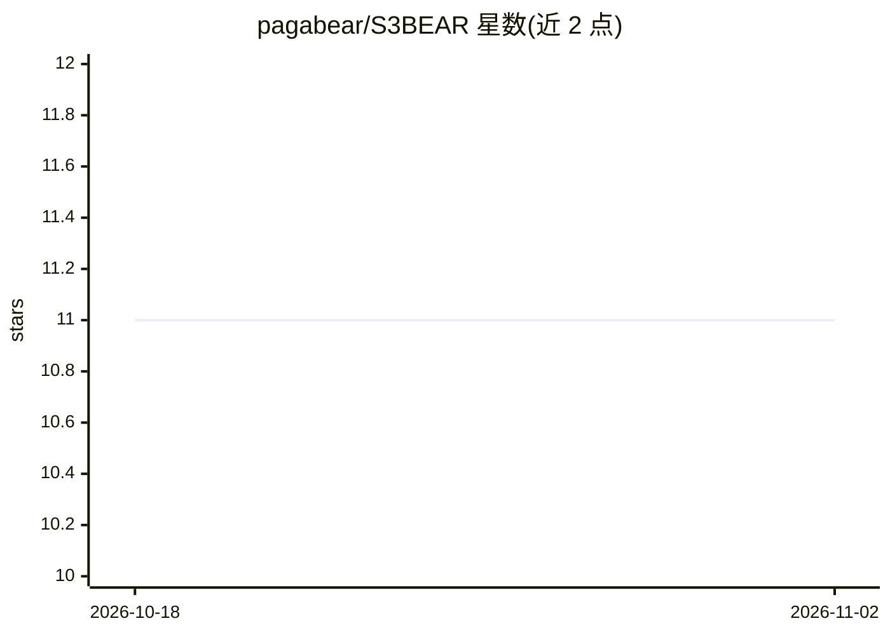

# pagabear/S3BEAR

⭐ 11 · Python · MIT · 推送 2026-09-21 · [GitHub](https://github.com/pagabear/S3BEAR) · 个人维护

**面向 AI 工作负载的自托管 S3 网关与 Web 控制台**

部署在私有 S3 兼容存储（AWS S3、MinIO、Ceph、Wasabi）前的访问网关：为单个对象签发可过期、可撤销的 HTTPS URL 供多模态 LLM API 直接拉取，桶本身保持私有；同时向浏览器提供带 JWT 权限校验、MIME 白名单和实时缩放的图片/文件服务。内置组级 glob 权限、按桶配额、审计日志、Azure Entra SSO，提供 Docker Compose 快速启动与生产 Kubernetes 的 Helm chart，可自带 S3 或使用内置 MinIO。面向需将私有存储内容安全交给 LLM 的开发与企业团队。

## 筛选速览

| 维度 | 判定 | 备注 |
|---|---|---|
| AI 角色 | `ai-ecosystem` | LLM/agent 周边工具 |
| 许可风险 | `permissive` | MIT |
| 部署形态 | `self-host` | docker 或自建部署 |
| 模型依赖 | — | README 未给出锁定关系 |
| 硬件要求 | — | 无带数字的原话,不猜 |
| 安装摩擦 | `low` | 无编译、无系统依赖或容器化 |
| 成熟度 | — | 结构信号不足 |

## 能力要点

- 为私有 S3 对象签发可过期/可撤销的 HTTPS URL 供 LLM 拉取
- JWT 权限校验、MIME 白名单与实时缩放（?w=&format=webp&q=）的图片服务
- 组级 glob 权限、按桶配额、全量审计日志与 Azure Entra SSO
- 一条 Docker 命令试用，Helm chart 部署生产 Kubernetes

## 适用场景

- 把私有桶里的图片以安全 URL 提供给 Claude/GPT-4o/Gemini 等多模态模型
- 向浏览器安全展示私有存储中的图片与文件而不公开桶
- 集中管理团队对多个 S3 后端的访问权限并留存审计记录

## 场景标签

 · 领域:云存储/AI 基础设施

## 证据(README 行号)

> L5: **Serve images and files from private S3 storage to LLMs and browsers —
> L41: - **Mint an expiring, revocable HTTPS URL** for one object and pass it straight to an LLM API. It works while valid
> L37: s3BEAR is that door. It sits in front of **any** S3-compatible backend (AWS S3, MinIO,

## 星数曲线

2026-10-18 11 → 2026-11-02 11（+0）

---
*卡片 v1 · prompt 1.4 · 生成 2026-11-02 · 置信度 high · 依据 README sha `7e99f683de14` · [字段定义](../../DATASET.md)*
