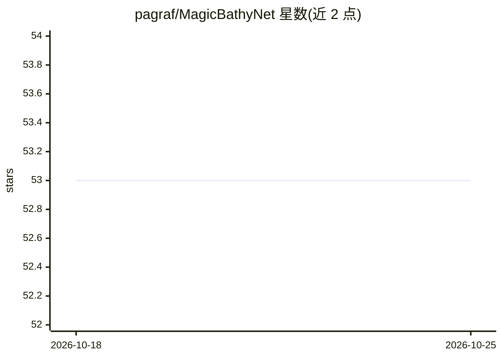

# pagraf/MagicBathyNet

⭐ 53 · Jupyter Notebook · NOASSERTION · 推送 2026-03-02 · [GitHub](https://github.com/pagraf/MagicBathyNet) · [官网](https://www.magicbathy.eu) · 组织维护

**浅水区多模态遥感基准数据集及水深预测与底质分类代码**

MagicBathyNet 是由 MagicBathy 项目（欧盟 HORIZON Europe 资助）发布的基准数据集，包含 Sentinel-2、SPOT-6 与航空影像的图像切片、栅格水深数据和海床类别标注，覆盖 Agia Napa 与 Puck Lagoon 两个区域，支持无监督预训练。仓库同时提供配套 Jupyter Notebook 代码，用于训练和测试基于学习的深度估计与像素级分类模型，并提供 U-Net、SegFormer 等在数据集上预训练的 PyTorch 权重下载。安装通过 conda 环境完成，需从项目网站另行下载数据集。

## 筛选速览

| 维度 | 判定 | 备注 |
|---|---|---|
| AI 角色 | `ai-knowledge` | 知识聚合/清单类 |
| 许可风险 | `none` | NOASSERTION |
| 部署形态 | `None` |  |
| 模型依赖 | — | README 未给出锁定关系 |
| 硬件要求 | — | 无带数字的原话,不猜 |
| 安装摩擦 | `low` | 无编译、无系统依赖或容器化 |
| 成熟度 | — | 结构信号不足 |

## 能力要点

- 多模态数据：Sentinel-2/SPOT-6/航空影像 + 栅格水深 + 海床类别标注
- 提供水深预测与像素级分类的训练/测试 Notebook
- U-Net、SegFormer 等 18 个预训练 PyTorch 模型权重（按模态×区域组合）
- 附 IGARSS 2024 论文与数据集 DOI

## 适用场景

- 在统一基准上比较学习型水深估计方法
- 浅水沿海区域的底质像素级分类研究与对比实验
- 利用多模态遥感影像做无监督预训练

## 场景标签

`多模态` `目标检测` · 领域:感知与多模态

## 证据(README 行号)

> L5: MagicBathyNet is a benchmark dataset made up of image patches of Sentinel-2, SPOT-6 and aerial imagery, bathymetry i
> L10: # Package for benchmarking MagicBathyNet dataset in learning-based bathymetry and pixel-based classification.

## 星数曲线

2026-10-18 53 → 2026-10-25 53（+0）

---
*卡片 v1 · prompt 1.4 · 生成 2026-10-24 · 置信度 high · 依据 README sha `7b765dae18f4` · [字段定义](../../DATASET.md)*
