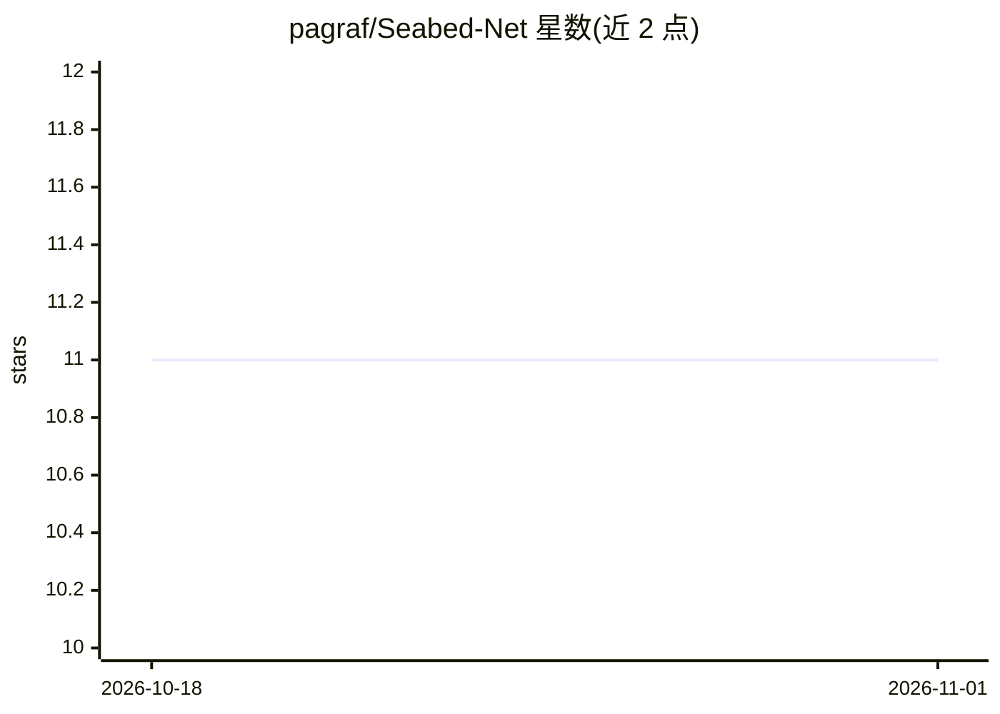

# pagraf/Seabed-Net

⭐ 11 · Python · NOASSERTION · 推送 2026-03-02 · [GitHub](https://github.com/pagraf/Seabed-Net) · [官网](https://www.magicbathy.eu) · 组织维护

**多任务网络：从浅水遥感影像同时估计水深与海底分类**

论文配套代码：Seabed-Net 采用双分支编码器，通过注意力特征融合（FAA）与 ViT/Swin-Transformer 融合模块联合估计水深和像素级海底分类，任务间用动态不确定性加权平衡；支持 aerial、SPOT 6、Sentinel-2 多种模态。提供 6 个预训练模型权重（Agia Napa 与 Puck Lagoon 两个站点）、conda 环境文件与训练/测试 notebook，数据集来自 MagicBathy 项目网站。需引用 ISPRS 期刊论文及 MagicBathyNet 数据集论文。

## 筛选速览

| 维度 | 判定 | 备注 |
|---|---|---|
| AI 角色 | `ai-native` | 本体是模型或模型工具 |
| 许可风险 | `none` | NOASSERTION |
| 部署形态 | `None` |  |
| 模型依赖 | — | README 未给出锁定关系 |
| 硬件要求 | — | 无带数字的原话,不猜 |
| 安装摩擦 | `low` | 无编译、无系统依赖或容器化 |
| 成熟度 | — | 结构信号不足 |

## 能力要点

- 双分支多任务架构同时输出水深图与像素级海底分类
- 注意力特征融合与 ViT/Swin-Transformer 融合模块
- 提供 6 个预训练权重（aerial/SPOT 6/Sentinel-2 × 两站点）
- conda environment.yml 一键配置环境，notebook 训练测试

## 适用场景

- 浅水区海岸带水深反演与海底栖息地制图
- 在自有卫星/航空影像上微调多任务模型
- 复现论文的多任务与单任务基线对比结果

## 场景标签

`目标检测` `模型训练` · 领域:感知与多模态

## 证据(README 行号)

> L14: Accurate, detailed, and regularly updated bathymetry, coupled with complex semantic content, is essential for under
> L49: Seabed-NeT jointly estimates bathymetric depth and performs pixel-level seabed classification from satellite and ae

## 星数曲线

2026-10-18 11 → 2026-11-01 11（+0）

---
*卡片 v1 · prompt 1.4 · 生成 2026-11-01 · 置信度 high · 依据 README sha `b832f1bbb010` · [字段定义](../../DATASET.md)*
