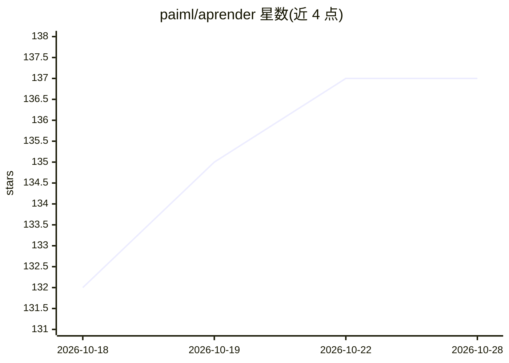

# paiml/aprender

⭐ 137 · Rust · MIT · 推送 2026-10-27 · [GitHub](https://github.com/paiml/aprender) · [官网](https://paiml.github.io/aprender/) · 组织维护

**纯 Rust 的机器学习框架与 apr 命令行工具链**

纯 Rust 编写的机器学习框架，覆盖完整模型生命周期：推理（run/chat/serve）、训练（train/finetune/pretrain/distill）、量化、转换、检查、性能分析与发布，由单一 apr 二进制与 81 个 workspace crate 提供，配套 YAML 可证明契约在 CI 中防漂移。经典算法库含线性/逻辑回归、决策树、随机森林、SVM、K-Means、PCA 等。支持从 HuggingFace 拉取 Qwen 系列模型并以 safetensors/GGUF 格式推理；限制：预编译安装仅覆盖 Linux x86_64/aarch64，0.69.1 中 qwen3moe 架构仅 CPU 运行。

## 筛选速览

| 维度 | 判定 | 备注 |
|---|---|---|
| AI 角色 | `ai-ecosystem` | LLM/agent 周边工具 |
| 许可风险 | `permissive` | MIT |
| 部署形态 | `library` | 以包/库形式分发 |
| 模型依赖 | — | README 未给出锁定关系 |
| 硬件要求 | `cpu-ok` | |
| 安装摩擦 | `medium` | 含编译或系统依赖之一 |
| 成熟度 | — | 结构信号不足 |

## 能力要点

- 113 个 CLI 命令覆盖推理/训练/模型操作/剖析/注册表
- 1996 条 YAML 可证明契约，README 数据漂移会使 CI 失败
- NVIDIA GPU 加速为 cargo 可选 feature（--features cuda）
- 提供 REST API 服务（apr serve，兼容 /v1/chat/completions 请求格式）

## 适用场景

- 用 cargo 一键安装后在本地运行与微调 Qwen 系列模型
- 对模型做量化、格式转换与逐张量差异检查
- 在 Rust 项目中以库形式使用回归、树模型等经典算法

## 场景标签

`微调` `模型量化` `推理引擎` `模型训练` · 领域:训练与推理

## 证据(README 行号)

> L56: A complete ML framework in pure Rust. One `cargo install`, one `apr` binary,
> L130: |**Inference**|`apr run`, `apr chat`, `apr serve`|

## 星数曲线

2026-10-18 132 → 2026-10-28 137（+5）

---
*卡片 v1 · prompt 1.4 · 生成 2026-10-22 · 置信度 high · 依据 README sha `05169bc979c8` · [字段定义](../../DATASET.md)*
