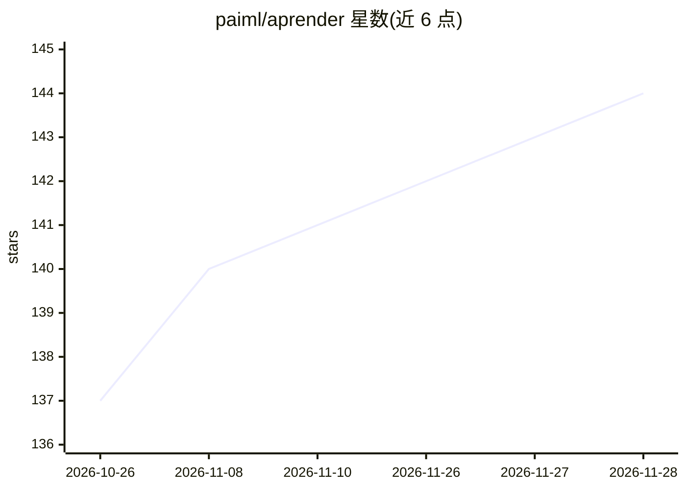

# paiml/aprender

⭐ 144 · Rust · MIT · 推送 2026-11-27 · [GitHub](https://github.com/paiml/aprender) · [官网](https://paiml.github.io/aprender/) · 组织维护

**纯 Rust 的 ML/统计/深度学习框架与 apr 模型生命周期 CLI**

以单一 `apr` 二进制覆盖模型全生命周期：推理（run/chat/serve）、训练（train/finetune/pretrain/distill）、量化/转换/合并/导出、性能剖析与模型发布，全部受 YAML 可证明契约约束并在漂移时使 CI 失败。可从 HuggingFace 拉取 GGUF/safetensors 模型本地运行，提供兼容 OpenAI 格式的 REST 接口。预编译二进制目前仅覆盖 Linux x86_64/aarch64，其他平台回落到 cargo install；CUDA 为可选 feature，MoE 架构在 CUDA 上尚不支持。也可作为 Rust 库使用（线性回归、随机森林、PCA、贝叶斯推断等算法）。

## 筛选速览

| 维度 | 判定 | 备注 |
|---|---|---|
| AI 角色 | `ai-ecosystem` | LLM/agent 周边工具 |
| 许可风险 | `permissive` | MIT |
| 部署形态 | `library` | 以包/库形式分发 |
| 模型依赖 | — | README 未给出锁定关系 |
| 硬件要求 | `cpu-ok` | |
| 安装摩擦 | `medium` | 含编译或系统依赖之一 |
| 成熟度 | — | 结构信号不足 |

## 能力要点

- 单一 apr 二进制覆盖推理、训练、量化、剖析、发布的完整模型生命周期
- YAML 可证明契约（1741 条）在漂移时使 CI 失败，README 数字由脚本校验
- 支持从 HuggingFace 拉取 Qwen 系列模型，CPU/GGUF 与 .apr 格式均可运行
- 115 个 CLI 命令，含 REST 服务、Roofline 剖析与容量规划

## 适用场景

- 在本地 CPU/GPU 上运行和量化 Qwen 等开源模型
- 用 Rust 库接口训练传统 ML 模型（回归、树模型、聚类等）
- 通过 REST API 部署本地模型服务
- 以契约门禁管理模型能力声明的可复现验证

## 场景标签

`模型量化` `推理引擎` `微调` `模型训练` · 领域:训练与推理

## 证据(README 行号)

> L56: A complete ML framework in pure Rust. One `cargo install`, one `apr` binary,
> L57: the full model lifecycle — inference, training, quantization, profiling,
> L130: |**Inference**|`apr run`, `apr chat`, `apr serve`|

## 星数曲线

2026-10-26 137 → 2026-11-28 144（+7）

---
*卡片 v1 · prompt 1.4 · 生成 2026-11-27 · 置信度 high · 依据 README sha `7905a61e3ef4` · [字段定义](../../DATASET.md)*
