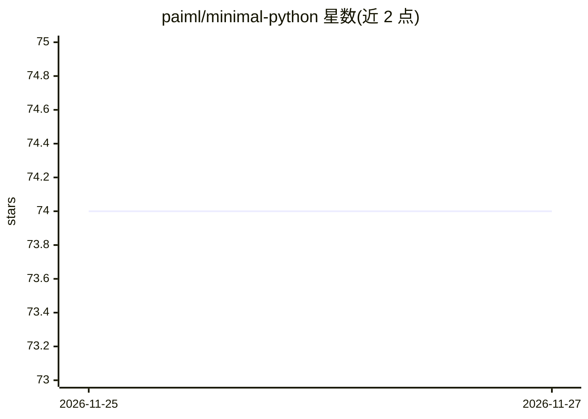

# paiml/minimal-python

⭐ 74 · Jupyter Notebook · NOASSERTION · 推送 2026-11-23 · [GitHub](https://github.com/paiml/minimal-python) · [官网](https://www.coursera.org/learn/ai-debugging?utm_source=github&utm_medium=repo_website&utm_campaign=funnel_2026q4&utm_content=minimal-python) · 组织维护

**《minimal Python》书籍的公开配套源码，供读者练习**

Pragmatic AI Labs 出版的《minimal Python》一书的公开源码仓库，按章节组织内容：Python 命令执行、数据存储、函数创建与测试、用 Click 构建命令行工具、Flask 构建Web 应用、Pandas 数据科学、sklearn 预测等。多数章节提供 Colab Notebook，面向书籍读者与 Python 初学者，需购买书籍配套阅读；仓库标注为 paiml-read-only。

## 筛选速览

| 维度 | 判定 | 备注 |
|---|---|---|
| AI 角色 | `ai-knowledge` | 知识聚合/清单类 |
| 许可风险 | `none` | NOASSERTION |
| 部署形态 | `None` |  |
| 模型依赖 | — | README 未给出锁定关系 |
| 硬件要求 | — | 无带数字的原话,不猜 |
| 安装摩擦 | `low` | 无编译、无系统依赖或容器化 |
| 成熟度 | — | 结构信号不足 |

## 能力要点

- 按章节组织的源码，覆盖测试、Click、Flask、Pandas、sklearn
- 章节 1/3 等提供 Colab Notebook 形式
- 含面试题解析与技术求职作品集章节

## 适用场景

- 配合书籍边读边跑 Colab Notebook 练习
- 学习用 Click 和 Flask 构建命令行与 Web 工具
- 准备技术面试中的算法与 Big O 题目

## 场景标签

`教程课程` · 领域:学习与行业

## 证据(README 行号)

> L17: # minimal-python
> L18: Public Source code for book minimal Python
> L25: * Chapter 1: Learn to execute commands in Python- Colab Notebooks

## 星数曲线

2026-11-25 74 → 2026-11-27 74（+0）

---
*卡片 v1 · prompt 1.4 · 生成 2026-11-24 · 置信度 high · 依据 README sha `b39fd5543ab7` · [字段定义](../../DATASET.md)*
