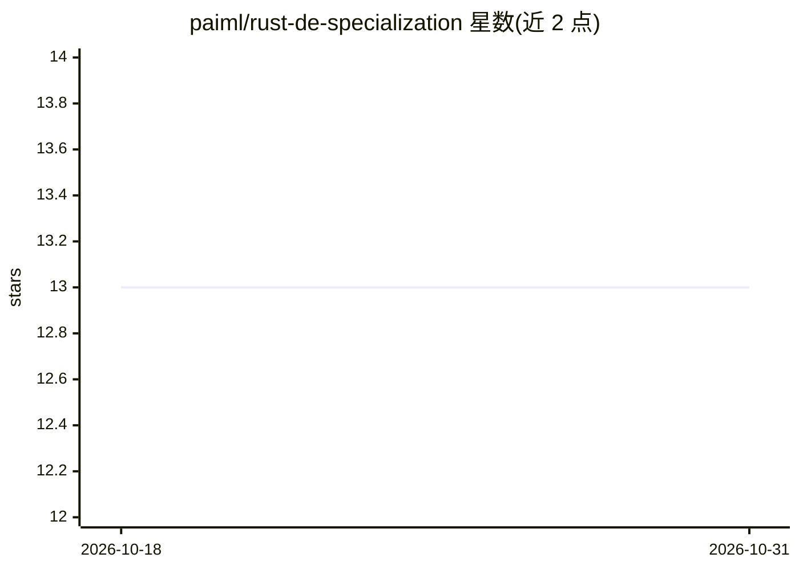

# paiml/rust-de-specialization

⭐ 13 · Makefile · MIT · 推送 2026-10-28 · [GitHub](https://github.com/paiml/rust-de-specialization) · 组织维护

**Rust 数据工程 Coursera 专项课程目录（31 门，含配套代码）**

Pragmatic AI Labs 维护的 Rust 数据工程教学仓库：编目 31 门已上线的 Coursera 课程，覆盖 Rust 基础、SQLite/DuckDB/Polars/Postgres、ETL、云上 Serverless（AWS/GCP）、RAG、Claude 工作流、Zig/WASM、可证明契约等，按发布顺序与推荐学习顺序两种视图组织。仓库本身提供 7 个示例 crate（Rust 1.95.0 工具链），用 cargo test 运行，Ubuntu 需 build-essential，macOS 需 Xcode 命令行工具。每门课含 capstone 项目，两门课提供浏览器内 Rust Playground 练习。课程内容版权归 Pragmatic AI Labs，代码示例 MIT。

## 筛选速览

| 维度 | 判定 | 备注 |
|---|---|---|
| AI 角色 | `ai-knowledge` | 知识聚合/清单类 |
| 许可风险 | `permissive` | MIT |
| 部署形态 | `None` |  |
| 模型依赖 | — | README 未给出锁定关系 |
| 硬件要求 | — | 无带数字的原话,不猜 |
| 安装摩擦 | `medium` | 含编译或系统依赖之一 |
| 成熟度 | — | 结构信号不足 |

## 能力要点

- 31 门课程全部已上线 Coursera，双视图（发布序/学习序）组织
- 课程覆盖 DuckDB、Polars、RAG、Serverless、可证明契约等主题
- 7 个示例 crate 可用 cargo test 构建，CI 同步骤运行
- 两门课提供零安装的 Rust Playground 浏览器练习

## 适用场景

- 按推荐顺序系统学习 Rust 数据工程
- 查找各课程配套仓库与 capstone 项目简报
- 在浏览器 Rust Playground 上预习课程核心概念

## 场景标签

`教程课程` `精选清单` · 领域:学习与行业

## 证据(README 行号)

> L10: **Fast, Reliable & Correct Data Pipelines in Rust.** A 31-Course Coursera Specialization that takes you from Rust f
> L28: Two views of the same 31 courses: **dashboard order** (publication order, below) and **recommended learning sequenc

## 星数曲线

2026-10-18 13 → 2026-10-31 13（+0）

---
*卡片 v1 · prompt 1.4 · 生成 2026-10-31 · 置信度 high · 依据 README sha `c814f58afd7f` · [字段定义](../../DATASET.md)*
