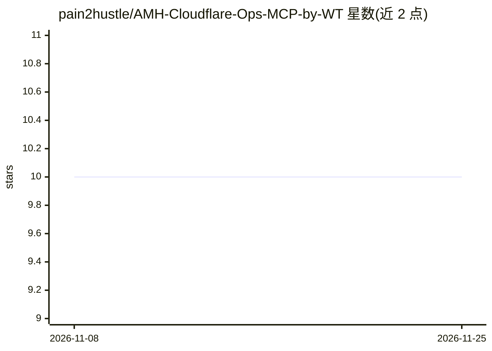

# pain2hustle/AMH-Cloudflare-Ops-MCP-by-WT

⭐ 10 · HTML · NOASSERTION · 推送 2026-11-23 · [GitHub](https://github.com/pain2hustle/AMH-Cloudflare-Ops-MCP-by-WT) · [官网](https://mcp.artificialmindhive.com) · 个人维护

**让 AI 在审批门控下安全操作你的 Cloudflare 站点的 MCP 工具集**

WT 是一套面向 AI agent 的 Cloudflare/GitHub 工具集（MCP server），核心机制是「先查看、展示变更、等用户批准、发布后再验证是否真正上线」；AI 不接触原始账户密钥，OAuth 凭据存于服务端。提供六种运行方式：CLI（cfops）、通过 WhatsApp/WALO 发短信由云端 agent 执行、作为库嵌入自有应用、作为 MCP connector 接入 Grok/Claude/ChatGPT 等客户端、用 Wrangler 自托管 MCP Worker、以及可选的 Private Agent Harness。自述为非官方第三方 Cloudflare 工具，MIT 许可，最新工具仅在托管服务提供。

## 筛选速览

| 维度 | 判定 | 备注 |
|---|---|---|
| AI 角色 | `ai-ecosystem` | LLM/agent 周边工具 |
| 许可风险 | `none` | NOASSERTION |
| 部署形态 | `library` | 以包/库形式分发 |
| 模型依赖 | — | README 未给出锁定关系 |
| 硬件要求 | — | 无带数字的原话,不猜 |
| 安装摩擦 | `low` | 无编译、无系统依赖或容器化 |
| 成熟度 | — | 结构信号不足 |

## 能力要点

- 审批门控写入：所有变更账户的操作需用户明确批准
- 发布验证门：检查公开目标 2xx 状态、拒绝重定向、可要求发布标记
- 可选 OAuth 连接官方 Cloudflare API、Workers Builds 等服务
- 短信即用：经 WALO 在 WhatsApp 下发任务，云端 agent 执行并回传验证结果

## 适用场景

- 不用电脑和终端，在手机上发短信让 AI 修改并验证站点配置
- 批量清理多 zone 的 SPF/DMARC/BIMI 等 DNS 记录并留审计日志
- 在 Claude Code/Codex 等 MCP 客户端中安全执行 Pages/Workers 部署

## 场景标签

 · 领域:开发者工具/云基础设施运维

## 证据(README 行号)

> L14: **AMH WT lets your AI work on your Cloudflare sites and GitHub repos safely: it looks first, shows you the change, 
> L86: AMH WT scans Cloudflare configuration, computes a **diff** of desired vs current **DNS / Email Routing / BIMI / DMA
> L103: > **Unofficial Cloudflare tool.** AMH WT is made by **AMH - Artificial Mind Hive**, operated by **Service Pricer L

## 星数曲线

2026-11-08 10 → 2026-11-25 10（+0）

---
*卡片 v1 · prompt 1.4 · 生成 2026-11-19 · 置信度 mid · 依据 README sha `0bf25cd9383e` · [字段定义](../../DATASET.md)*
