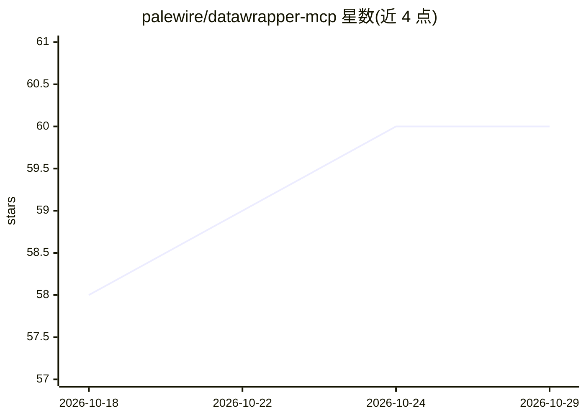

# palewire/datawrapper-mcp

⭐ 60 · Python · MIT · 推送 2026-10-01 · [GitHub](https://github.com/palewire/datawrapper-mcp) · 个人维护

**让 AI 助手通过 MCP 创建 Datawrapper 图表的服务器与应用**

基于 datawrapper Python 库构建的 MCP 服务器与应用，向 Claude Desktop、Claude.ai、Claude Code、Cursor、VS Code Copilot、ChatGPT、OpenAI Codex 等客户端提供 8 个图表工具：列出图表类型、读取配置 schema、创建/更新/发布/删除图表、导出 PNG，支持 bar、line、area、scatter 等类型。用户在对话中提供数据并描述需求即可生成图表。需 Datawrapper 账号与 API token，token 可经 Authorization 头、工具参数或环境变量传入；支持自定义指令注入编辑部风格规则。README 自声明为早期实验性项目，插件市场安装路径存在已知缺口。

## 筛选速览

| 维度 | 判定 | 备注 |
|---|---|---|
| AI 角色 | `ai-ecosystem` | LLM/agent 周边工具 |
| 许可风险 | `permissive` | MIT |
| 部署形态 | `library` | 以包/库形式分发 |
| 模型依赖 | — | README 未给出锁定关系 |
| 硬件要求 | — | 无带数字的原话,不猜 |
| 安装摩擦 | `low` | 无编译、无系统依赖或容器化 |
| 成熟度 | `idea` | |

## 能力要点

- 8 个 MCP 工具：创建/更新/发布/删除/导出图表与读取 schema
- 通过 DATAWRAPPER_MCP_INSTRUCTIONS 注入自定义图表规范
- 托管部署下用户可用自己的 API token 认证
- 支持 Claude Desktop/Claude.ai/Cursor/ChatGPT 等 8 种客户端

## 适用场景

- 在聊天中对数据文件直接生成并发布 Datawrapper 图表
- 新闻编辑室用 AI 助手按固定风格规范批量制作图表
- 在自有客户端中通过 MCP 接入 Datawrapper 图表工作流

## 场景标签

 · 领域:数据可视化/数据新闻

## 证据(README 行号)

> L5: A Model Context Protocol (MCP) server and app for creating Datawrapper charts using AI assistants. Built on the data
> L72: For other clients (Claude Desktop, Claude.ai, Cursor, VS Code Copilot, ChatGPT, OpenAI Codex, OpenClaw) and Kuberne

## 星数曲线

2026-10-18 58 → 2026-10-29 60（+2）

---
*卡片 v1 · prompt 1.4 · 生成 2026-10-24 · 置信度 high · 依据 README sha `4aee0198062b` · [字段定义](../../DATASET.md)*
