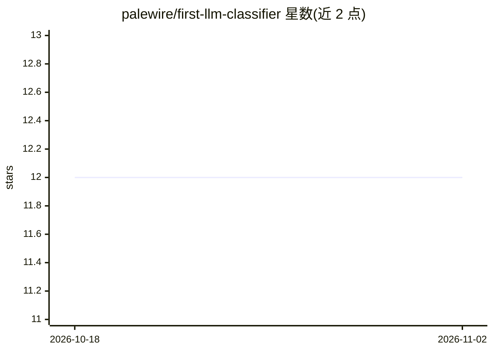

# palewire/first-llm-classifier

⭐ 12 · Jupyter Notebook · MIT · 推送 2026-10-01 · [GitHub](https://github.com/palewire/first-llm-classifier) · [官网](https://palewi.re/docs/first-llm-classifier/) · 个人维护

**面向记者的 LLM 分类数据集教程课程**

由 palewire 维护的教学仓库，主题为新闻从业者如何使用大语言模型对大规模数据集进行组织与分析。README 仅给出课程标题、简介与链接列表（教程、贡献方式、系列课程），内容以教程形式组织，使用 Sphinx 构建文档、代码为 Python。仓库提供的是教学材料而非可直接安装运行的软件产品，具体课程内容需通过教程链接查看。

## 筛选速览

| 维度 | 判定 | 备注 |
|---|---|---|
| AI 角色 | `ai-knowledge` | 知识聚合/清单类 |
| 许可风险 | `permissive` | MIT |
| 部署形态 | `None` |  |
| 模型依赖 | — | README 未给出锁定关系 |
| 硬件要求 | — | 无带数字的原话,不猜 |
| 安装摩擦 | `low` | 无编译、无系统依赖或容器化 |
| 成熟度 | — | 结构信号不足 |

## 能力要点

- 主题：记者使用 LLM 组织与分析大规模数据集
- 教程形式，含贡献指南与系列课程链接
- 技术栈包含 Python 与 Sphinx 文档构建

## 适用场景

- 新闻从业者学习用 LLM 做数据分类
- 数据新闻课程的教学材料
- 了解新闻行业应用 LLM 的入门路径

## 场景标签

`教程课程` · 领域:学习与行业

## 证据(README 行号)

> L3: Learn how journalists use large-language models to organize and analyze massive datasets

## 星数曲线

2026-10-18 12 → 2026-11-02 12（+0）

---
*卡片 v1 · prompt 1.4 · 生成 2026-11-01 · 置信度 mid · 依据 README sha `5ac21059e4a3` · [字段定义](../../DATASET.md)*
