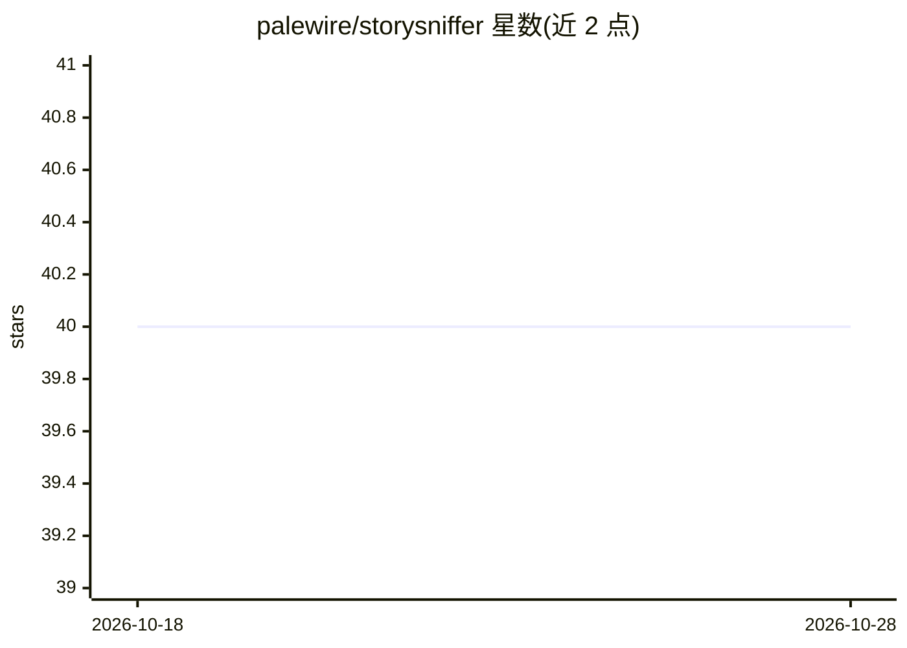

# palewire/storysniffer

⭐ 40 · Jupyter Notebook · NOASSERTION · 推送 2026-02-11 · [GitHub](https://github.com/palewire/storysniffer) · [官网](https://palewi.re/docs/storysniffer/) · 个人维护

**检测 URL 并估计其是否包含新闻文章的 Python 工具**

提供输入 URL 并估计该链接是否包含新闻故事的机器学习分类功能，基于 Python 与 scikit-learn 构建，主题标签指向数据新闻与 NLP 场景。README 仅包含文档、Issues、PyPI 打包与 CI 测试的链接，未展示安装命令或模型细节；具体用法需查阅其文档站点。适合需要批量筛选新闻链接的开发者或数据新闻从业者。

## 筛选速览

| 维度 | 判定 | 备注 |
|---|---|---|
| AI 角色 | `ai-native` | 本体是模型或模型工具 |
| 许可风险 | `none` | NOASSERTION |
| 部署形态 | `library` | 以包/库形式分发 |
| 模型依赖 | — | README 未给出锁定关系 |
| 硬件要求 | — | 无带数字的原话,不猜 |
| 安装摩擦 | `low` | 无编译、无系统依赖或容器化 |
| 成熟度 | — | 结构信号不足 |

## 能力要点

- 对 URL 进行是否包含新闻故事的估计（分类预测）
- 基于 Python 与 scikit-learn 构建
- 发布于 PyPI，可 pip 安装

## 适用场景

- 批量筛选链接，判断哪些指向新闻文章
- 数据新闻项目中过滤非新闻 URL
- 构建新闻语料采集管道的前置过滤环节

## 场景标签

 · 领域:NLP/数据新闻

## 证据(README 行号)

> L5: * Packaging: pypi.python.org/pypi/storysniffer

## 星数曲线

2026-10-18 40 → 2026-10-28 40（+0）

---
*卡片 v1 · prompt 1.4 · 生成 2026-10-25 · 置信度 mid · 依据 README sha `ebaa9cf05093` · [字段定义](../../DATASET.md)*
