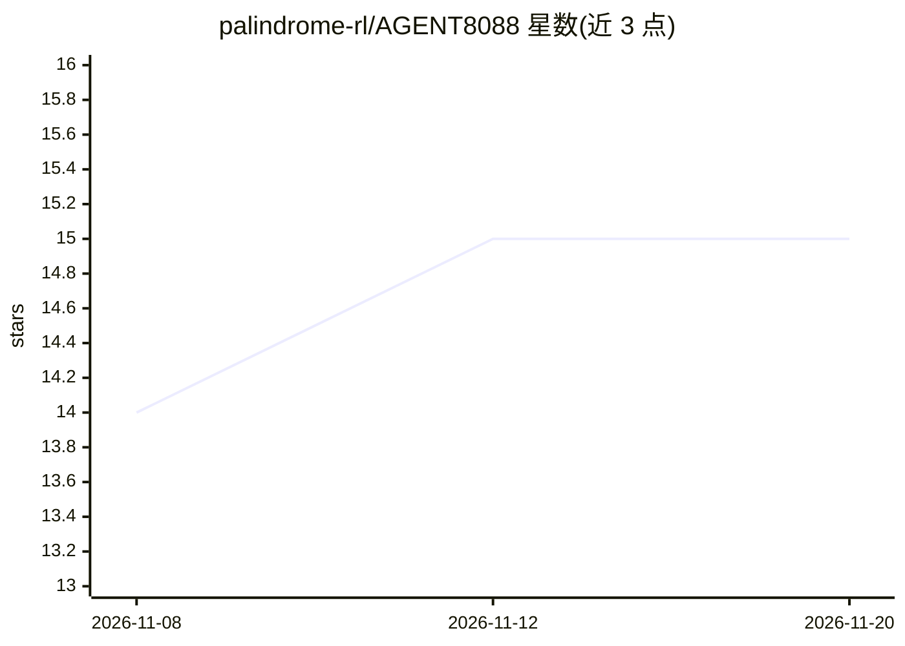

# palindrome-rl/AGENT8088

⭐ 15 · Python · MIT · 推送 2026-11-19 · [GitHub](https://github.com/palindrome-rl/AGENT8088) · [官网](https://palindromerl.com) · 组织维护

**面向小模型可靠任务完成的开源 agent 运行框架**

Palindrome Research Labs 开源的 agentic harness，围绕模型处理小模型常见失败模式：上下文预算与压缩、工具调用解析与校验、验证门控的任务完成判定、失败回滚与可恢复任务。提供 59 个内置工具、MCP 客户端/服务端、6 个子代理配置、39 个技能包、12 个 provider 配置，以及 CLI、Web UI 与 Slack/Discord/WhatsApp/Telegram/邮件网关等前端。通过 install.sh/install.ps1 安装，安装器自动配置隔离 Python 环境、Playwright Chromium、Node.js 22 与原生沙箱；支持 macOS/Linux/Windows/WSL2。

## 筛选速览

| 维度 | 判定 | 备注 |
|---|---|---|
| AI 角色 | `ai-ecosystem` | LLM/agent 周边工具 |
| 许可风险 | `permissive` | MIT |
| 部署形态 | `library` | 以包/库形式分发 |
| 模型依赖 | local-ok | 支持本地模型 |
| 硬件要求 | — | 无带数字的原话,不猜 |
| 安装摩擦 | `low` | 无编译、无系统依赖或容器化 |
| 成熟度 | — | 结构信号不足 |

## 能力要点

- 验证门控完成：任务输出、测试与工具结果核验后才报告完成
- 上下文预算、压缩保留指令原文与持久任务状态
- 59 个内置工具、MCP 客户端/服务端、6 子代理、39 技能包
- 权限模式、SSRF/出网控制、OS 级沙箱与审计日志

## 适用场景

- 在本地小模型上跑长任务并依赖验证门控确认真实完成
- 通过 CLI、Web UI 或 Slack/Telegram 等聊天前端运行同一 agent
- 用 MCP、技能包与子代理扩展 agent 能力

## 场景标签

`Agent 框架` · 领域:Agent 开发

## 证据(README 行号)

> L35: Agent8088 is an open-source agentic harness from Palindrome Research Labs, built to make small local models finish 
> L43: Apart from focusing on small models reliability, Agent8088 is a complete agentic harness, with broad tooling, web r

## 星数曲线

2026-11-08 14 → 2026-11-20 15（+1）

---
*卡片 v1 · prompt 1.4 · 生成 2026-11-18 · 置信度 mid · 依据 README sha `ce48da472e75` · [字段定义](../../DATASET.md)*
