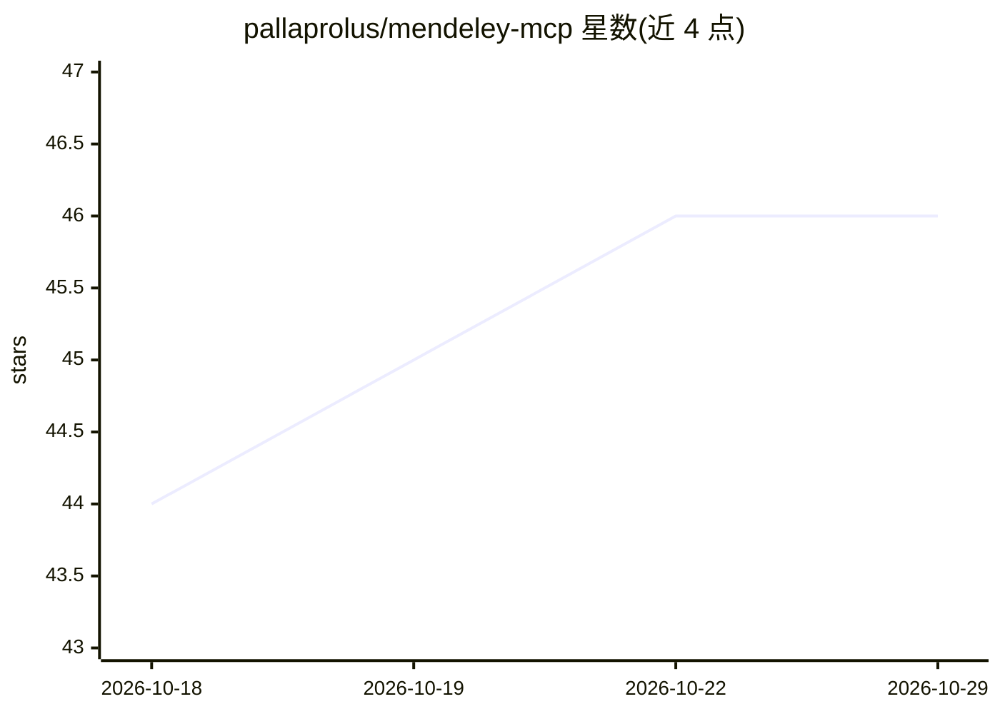

# pallaprolus/mendeley-mcp

⭐ 46 · Python · MIT · 推送 2026-10-13 · [GitHub](https://github.com/pallaprolus/mendeley-mcp) · 个人维护

**把 Mendeley 文献库接入 LLM 客户端的 MCP 服务器**

面向 Claude Desktop、Cursor 等 MCP 客户端的 Model Context Protocol 服务器：通过 Mendeley API 连接用户的文献库，提供 19 个工具，覆盖库内检索、全局目录（1 亿+ 论文）检索、DOI 查询、文档增删改、文件夹管理、PDF 批注读取、BibTeX 导出及服务端 PDF 全文提取（上限 20 万字符）。认证采用 Elsevier OAuth 授权码流程，凭据存入系统 keyring。需先注册 Mendeley API 应用；Python 3.10+，经 pip/uv/Docker/源码安装。扫描版 PDF 无文本层，需 OCR。

## 筛选速览

| 维度 | 判定 | 备注 |
|---|---|---|
| AI 角色 | `ai-ecosystem` | LLM/agent 周边工具 |
| 许可风险 | `permissive` | MIT |
| 部署形态 | `self-host` | docker 或自建部署 |
| 模型依赖 | — | README 未给出锁定关系 |
| 硬件要求 | — | 无带数字的原话,不猜 |
| 安装摩擦 | `low` | 无编译、无系统依赖或容器化 |
| 成熟度 | — | 结构信号不足 |

## 能力要点

- 19 个 MCP 工具覆盖检索、目录查询、文档/文件夹管理与 BibTeX 导出
- 服务端提取 PDF 全文供模型阅读（上限 20 万字符，可配置）
- 读取用户在 PDF 上的高亮与批注
- 凭据存于系统 keyring，支持 Docker 运行

## 适用场景

- 让 Claude 等客户端直接检索和浏览我的文献库
- 文献综述中按 DOI 找论文、整理文件夹并导出 BibTeX
- 让模型阅读库内论文全文并做总结或问答

## 场景标签

`科研工具` · 领域:学习与行业

## 证据(README 行号)

> L5: An MCP (Model Context Protocol) server that connects your Mendeley reference library to LLM applications like Claude
> L129: |Tool|Description|

## 星数曲线

2026-10-18 44 → 2026-10-29 46（+2）

---
*卡片 v1 · prompt 1.4 · 生成 2026-10-25 · 置信度 mid · 依据 README sha `6fa615533fda` · [字段定义](../../DATASET.md)*
