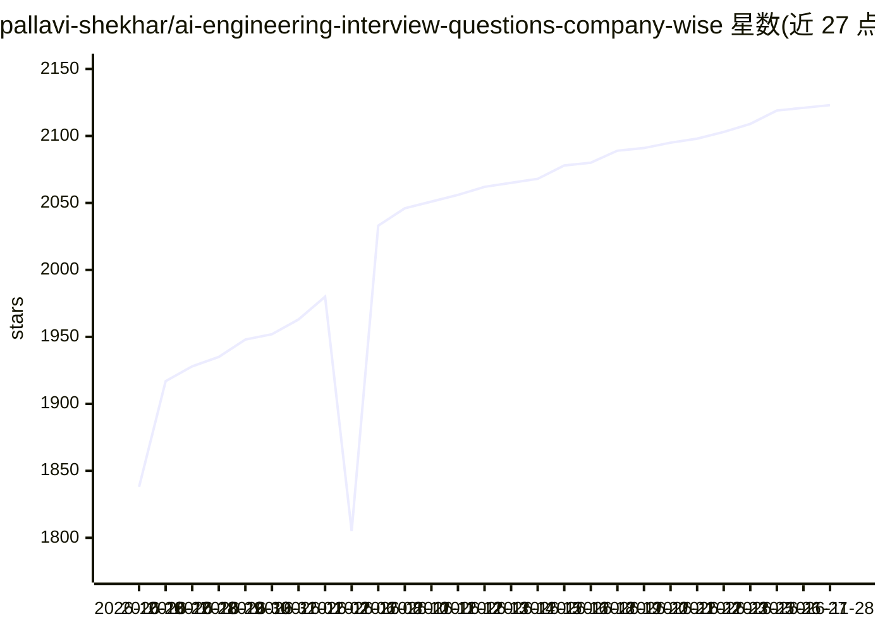

# pallavi-shekhar/ai-engineering-interview-questions-company-wise

⭐ 2,123 · Markdown · Apache-2.0 · 推送 2026-11-27 · [GitHub](https://github.com/pallavi-shekhar/ai-engineering-interview-questions-company-wise) · [官网](https://outcomeschool.com/program/ai-and-machine-learning) · 组织维护

**面向 AI 工程求职者的公司分面面试题与答案速查清单**

由 Outcome School 维护的面试题汇编：从公开报道的面试经历中收集 35 家公司的 AI 工程面试题，按公司分节组织，并先给出跨公司高频通用题；每题标注出现过的公司，部分题目附外部答案链接。覆盖 LLM 架构、推理与服务、RAG、Agent 与工具调用、微调与对齐等主题，适用于 AI/LLM/Agent/MLOps 等岗位的面试准备。README 明确声明内容非机密，且持续更新。

## 筛选速览

| 维度 | 判定 | 备注 |
|---|---|---|
| AI 角色 | `ai-knowledge` | 知识聚合/清单类 |
| 许可风险 | `permissive` | Apache-2.0 |
| 部署形态 | `None` |  |
| 模型依赖 | — | README 未给出锁定关系 |
| 硬件要求 | — | 无带数字的原话,不猜 |
| 安装摩擦 | `medium` | 含编译或系统依赖之一 |
| 成熟度 | — | 结构信号不足 |

## 能力要点

- 汇总 35 家公司的面试题，按公司分节组织
- 跨公司高频题单独列出并标注提问公司
- 部分题目附外部答案链接
- 覆盖 LLM 架构、推理优化、RAG、Agent、微调等主题

## 适用场景

- 准备 OpenAI、Meta、NVIDIA 等公司的 AI 工程面试
- 按目标公司查阅其面试考察重点与流程
- 系统复习 KV cache、量化、RAG、Agent 等知识点

## 场景标签

`教程课程` `精选清单` · 领域:学习与行业

## 证据(README 行号)

> L7: > Real interview questions asked in AI Engineering interviews at 35 companies, organized company by company, with an
> L46: - Questions are compiled from publicly reported interview experiences. Nothing here is confidential. Interview loop
> L55: ### LLM Internals and Architecture

## 星数曲线

2026-10-26 1,838 → 2026-11-28 2,123（+285）

---
*卡片 v1 · prompt 1.4 · 生成 2026-11-28 · 置信度 high · 依据 README sha `99ced6063d19` · [字段定义](../../DATASET.md)*
