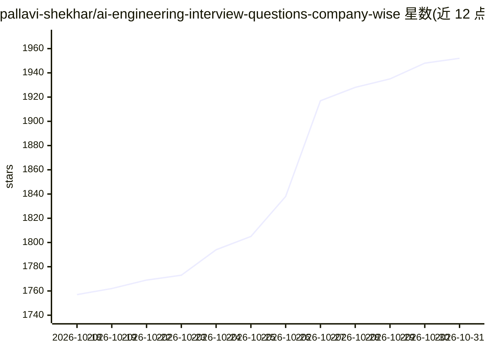

# pallavi-shekhar/ai-engineering-interview-questions-company-wise

⭐ 1,952 · Markdown · Apache-2.0 · 推送 2026-10-30 · [GitHub](https://github.com/pallavi-shekhar/ai-engineering-interview-questions-company-wise) · [官网](https://outcomeschool.com/program/ai-and-machine-learning) · 组织维护

**按公司整理的 35 家 AI 公司工程面试题与答案清单**

由 Outcome School 维护的 AI 工程面试题聚合仓库：收录公开报道的 35 家公司（OpenAI、Meta、NVIDIA、Anthropic 等）真实面试题，先列出跨公司高频共性问题，再按公司分节展示各岗位面试轮次与公司专属题目。题目覆盖 LLM 内部机制、推理服务与 GPU 性能、RAG 与检索、Agent 与工具调用、微调与对齐等主题，部分题目附答案链接。内容来自公开渠道，仓库持续更新。

## 筛选速览

| 维度 | 判定 | 备注 |
|---|---|---|
| AI 角色 | `ai-knowledge` | 知识聚合/清单类 |
| 许可风险 | `permissive` | Apache-2.0 |
| 部署形态 | `None` |  |
| 模型依赖 | — | README 未给出锁定关系 |
| 硬件要求 | — | 无带数字的原话,不猜 |
| 安装摩擦 | `medium` | 含编译或系统依赖之一 |
| 成熟度 | — | 结构信号不足 |

## 能力要点

- 35 家 AI 公司的面试题按公司分节组织
- 跨公司高频共性问题单独列出并标注提问公司
- 覆盖 LLM 内部机制、推理优化、RAG、Agent、微调对齐五大主题
- 部分题目附带答案链接，内容持续更新

## 适用场景

- 求职者按目标公司准备 AI 工程面试
- 了解各公司 AI 工程面试关注的主题分布
- 按 LLM 推理、RAG、Agent 等专题复习高频面试题

## 场景标签

`精选清单` · 领域:学习与行业

## 证据(README 行号)

> L7: > Real interview questions asked in AI Engineering interviews at 35 companies, organized company by company, with an
> L9: > These interview questions and answers are helpful for roles such as:

## 星数曲线

2026-10-18 1,757 → 2026-10-31 1,952（+195）

---
*卡片 v1 · prompt 1.4 · 生成 2026-10-21 · 置信度 high · 依据 README sha `11e188a88ae7` · [字段定义](../../DATASET.md)*
