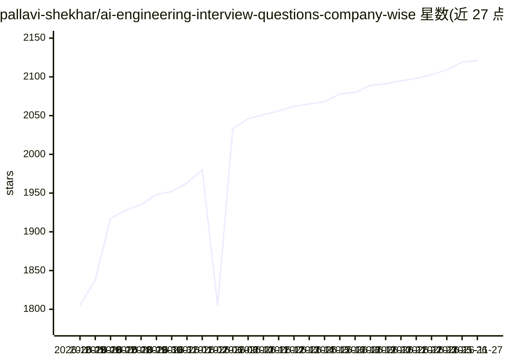

# pallavi-shekhar/ai-engineering-interview-questions-company-wise

⭐ 2,121 · Markdown · Apache-2.0 · 推送 2026-11-26 · [GitHub](https://github.com/pallavi-shekhar/ai-engineering-interview-questions-company-wise) · [官网](https://outcomeschool.com/program/ai-and-machine-learning) · 组织维护

**面向 AI 工程求职者的 35 家公司面试题整理清单**

由 Outcome School 维护的面试题汇编：收录 35 家公司公开报道的 AI 工程面试题，按公司分节组织，覆盖 AI Engineer、LLM Engineer、MLOps 等 15 类岗位。题目按主题分组（LLM 内部机制、推理与 GPU 性能、RAG、Agent、微调与对齐等），每题标注出题公司并提供外部答案链接。README 说明题目来自公开渠道，不保证覆盖具体面试流程，并会持续更新。

## 筛选速览

| 维度 | 判定 | 备注 |
|---|---|---|
| AI 角色 | `ai-knowledge` | 知识聚合/清单类 |
| 许可风险 | `permissive` | Apache-2.0 |
| 部署形态 | `None` |  |
| 模型依赖 | — | README 未给出锁定关系 |
| 硬件要求 | — | 无带数字的原话,不猜 |
| 安装摩擦 | `medium` | 含编译或系统依赖之一 |
| 成熟度 | — | 结构信号不足 |

## 能力要点

- 35 家公司分节整理的真实面试题
- 按 LLM 内部机制/推理服务/RAG/Agent/微调等主题分组
- 每题附出题公司列表与答案链接
- 另有跨公司通用高频问题汇总

## 适用场景

- 准备 AI Engineer 岗位面试前按目标公司刷题
- 查漏补缺 LLM 推理、RAG、Agent 等主题的知识盲区
- 了解不同公司面试关注点的分布

## 场景标签

`教程课程` · 领域:学习与行业

## 证据(README 行号)

> L7: > Real interview questions asked in AI Engineering interviews at 35 companies, organized company by company, with an
> L46: - Questions are compiled from publicly reported interview experiences. Nothing here is confidential. Interview loop
> L51: ## Common Questions Asked Across Companies

## 星数曲线

2026-10-25 1,805 → 2026-11-27 2,121（+316）

---
*卡片 v1 · prompt 1.4 · 生成 2026-11-27 · 置信度 high · 依据 README sha `4e955f27c104` · [字段定义](../../DATASET.md)*
