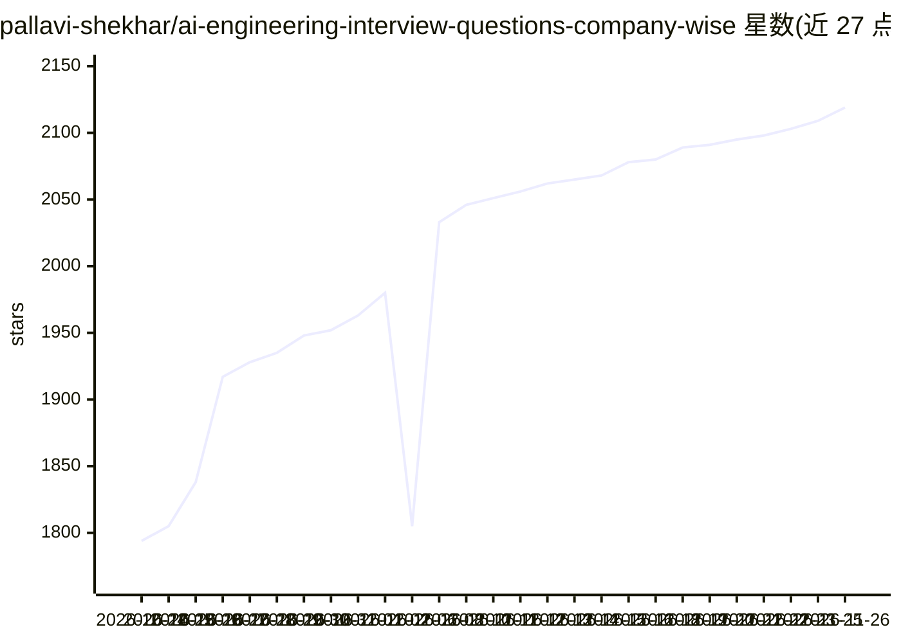

# pallavi-shekhar/ai-engineering-interview-questions-company-wise

⭐ 2,119 · Markdown · Apache-2.0 · 推送 2026-11-25 · [GitHub](https://github.com/pallavi-shekhar/ai-engineering-interview-questions-company-wise) · [官网](https://outcomeschool.com/program/ai-and-machine-learning) · 组织维护

**面向 AI 工程求职者的 35 家公司面试题整理清单**

由 Outcome School 维护的面试题汇编，收录 35 家公司公开报道的 AI 工程面试问题，按公司分节组织，并设有跨公司高频题专区。主题覆盖 LLM 内部机制、推理与服务、GPU 性能、RAG、Agent、微调与对齐等；每题标注被问及的公司，已有答案以外部链接形式挂在题目下方。README 说明内容持续更新，并提示面试流程随团队、级别和地区而变。

## 筛选速览

| 维度 | 判定 | 备注 |
|---|---|---|
| AI 角色 | `ai-knowledge` | 知识聚合/清单类 |
| 许可风险 | `permissive` | Apache-2.0 |
| 部署形态 | `None` |  |
| 模型依赖 | — | README 未给出锁定关系 |
| 硬件要求 | — | 无带数字的原话,不猜 |
| 安装摩擦 | `medium` | 含编译或系统依赖之一 |
| 成熟度 | — | 结构信号不足 |

## 能力要点

- 收录 35 家公司公开报道的面试题，按公司分节组织
- 跨公司高频题专区，每题标注所问公司
- 主题覆盖 LLM 推理优化、RAG、Agent、微调对齐等
- 答案以外部文章/视频链接提供并持续补充

## 适用场景

- 准备 AI 工程师/LLM 工程师岗位面试
- 按目标公司查看其面试重点与流程
- 系统学习 LLM 推理、RAG、Agent 等主题概念

## 场景标签

`教程课程` `精选清单` · 领域:学习与行业

## 证据(README 行号)

> L7: > Real interview questions asked in AI Engineering interviews at 35 companies, organized company by company, with an
> L44: ## How to use this
> L51: ## Common Questions Asked Across Companies

## 星数曲线

2026-10-24 1,794 → 2026-11-26 2,119（+325）

---
*卡片 v1 · prompt 1.4 · 生成 2026-11-23 · 置信度 high · 依据 README sha `473bfb840de9` · [字段定义](../../DATASET.md)*
