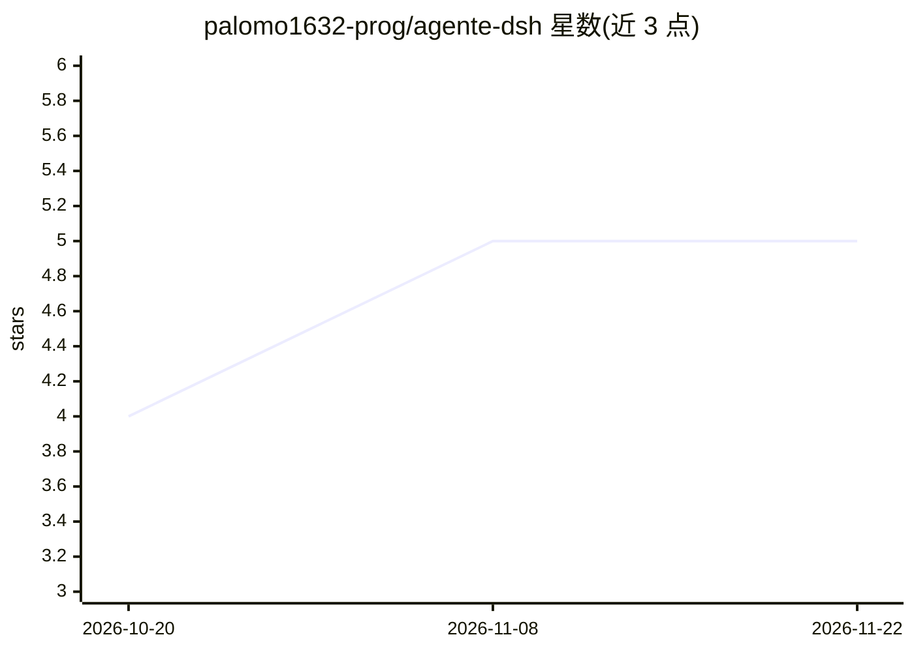

# palomo1632-prog/agente-dsh

⭐ — · [GitHub]() · 个人维护

**自托管在 VPS 上的西班牙语 Telegram 个人 AI 代理**

运行在用户自有 VPS 上的 Telegram 代理，组合 DSH Harness、Mnemosyne 长短期记忆、可选 Camoufox 反检测浏览器与住宅代理。通过 Telegram 按钮完成审批与项目切换，维护 25 行上限的全局 AGENTS.md 用户档案，安装流程由用户本地的编程代理读取 INSTALL-PROMPT.md 在 VPS 上执行。默认建议 DeepSeek API key，可按 docs 换用其他供应商。

## 筛选速览

| 维度 | 判定 | 备注 |
|---|---|---|
| AI 角色 | `ai-native` | 本体是模型或模型工具 |
| 许可风险 | `none` | — |
| 部署形态 | `None` |  |
| 模型依赖 | locked-api |  |
| 硬件要求 | — | 无带数字的原话,不猜 |
| 安装摩擦 | `low` | 无编译、无系统依赖或容器化 |
| 成熟度 | — | 结构信号不足 |

## 能力要点

- 长短期记忆（Mnemosyne）与 25 行上限的全局用户档案文件
- Telegram 按钮式审批、语音留言（ElevenLabs/Whisper 转录，可选）与 /cambiarproyecto 项目切换
- 安装由本地编程代理读取 INSTALL-PROMPT.md 自动完成
- 供应商可替换：默认 DeepSeek，文档说明切换到 ChatGPT/Claude 或本地模型

## 适用场景

- 通过 Telegram 让代理处理提醒、邮件回复与日常助理任务
- 远程让代理修改多个客户网站项目
- 监控 Meta/TikTok 广告并汇总异常
- 管理多个人主页的评论与内容发布

## 场景标签

`AI 助手` `Agent 记忆` · 领域:Agent 开发

## 证据(README 行号)

> L39: - Un bot de Telegram que responde desde tu VPS (siempre prendido, siempre tuyo)
> L60: |Una API key de DeepSeek *(sugerido)*|el cerebro del agente — **podés usar el proveedor que quieras** (ChatGPT, Cla

## 星数曲线

2026-10-20 4 → 2026-11-22 5（+1）

---
*卡片 v1 · prompt 1.4 · 生成 2026-11-21 · 置信度 high · 依据 README sha `eac76d46f8b4` · [字段定义](../../DATASET.md)*
