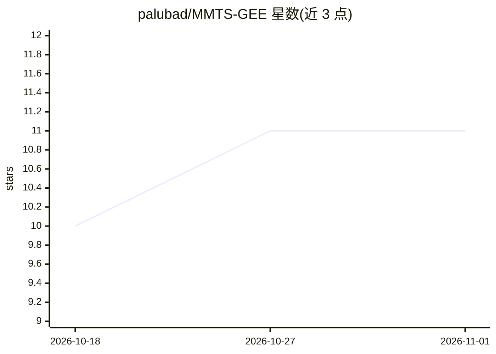

# palubad/MMTS-GEE

⭐ 11 · JavaScript · GPL-3.0 · 推送 2025-11-09 · [GitHub](https://github.com/palubad/MMTS-GEE) · 个人维护

**GEE 工具：生成多模态多时相遥感数据集供机器学习用**

运行于 Google Earth Engine 的数据集生成工具：产出空间与时序对齐的 Sentinel-1 GRD SAR（含斑点滤波与极化指数）、Sentinel-2 L2A 多光谱（云掩膜与植被指数）、ERA5-Land 气候变量及 Copernicus DEM 地形特征，并附带 ESA WorldCover 2021 土地覆盖标签。用户可自定义感兴趣区、时间范围、点生成方式、指数选择、斑点滤波与配对时差等参数，以 Web App 或 GEE 仓库两种方式访问，为多模态多时相分析与机器学习任务提供训练数据。

## 筛选速览

| 维度 | 判定 | 备注 |
|---|---|---|
| AI 角色 | `ai-ecosystem` | LLM/agent 周边工具 |
| 许可风险 | `viral` | GPL-3.0 |
| 部署形态 | `None` |  |
| 模型依赖 | — | README 未给出锁定关系 |
| 硬件要求 | — | 无带数字的原话,不猜 |
| 安装摩擦 | `low` | 无编译、无系统依赖或容器化 |
| 成熟度 | — | 结构信号不足 |

## 能力要点

- S1 SAR、S2 光学、ERA5-Land 气候与 DEM 数据的空间与时序对齐
- 支持随机点生成（按 ESA WorldCover 土地覆盖）或导入自定义 FeatureCollection
- 可配置斑点滤波（Lee 滤波核窗口）、S1-S2 配对时差与空值处理策略
- 提供 GEE Web App 与 GEE 仓库两种访问方式

## 适用场景

- 为遥感机器学习任务构建多模态多时相训练数据集
- 按指定土地覆盖类型生成带缓冲区的采样点并导出时序特征
- 森林监测等研究中的 SAR/光学配对时序数据准备

## 场景标签

 · 领域:地球观测/遥感

## 证据(README 行号)

> L12: The MMTS-GEE is designed to efficiently generate comprehensive datasets for multi-modal and multi-temporal analyses
> L2: A Google Earth Engine tool to generate multi-modal and time series datasets with spatially and temporally aligned:

## 星数曲线

2026-10-18 10 → 2026-11-01 11（+1）

---
*卡片 v1 · prompt 1.4 · 生成 2026-11-01 · 置信度 high · 依据 README sha `980ae53fc834` · [字段定义](../../DATASET.md)*
