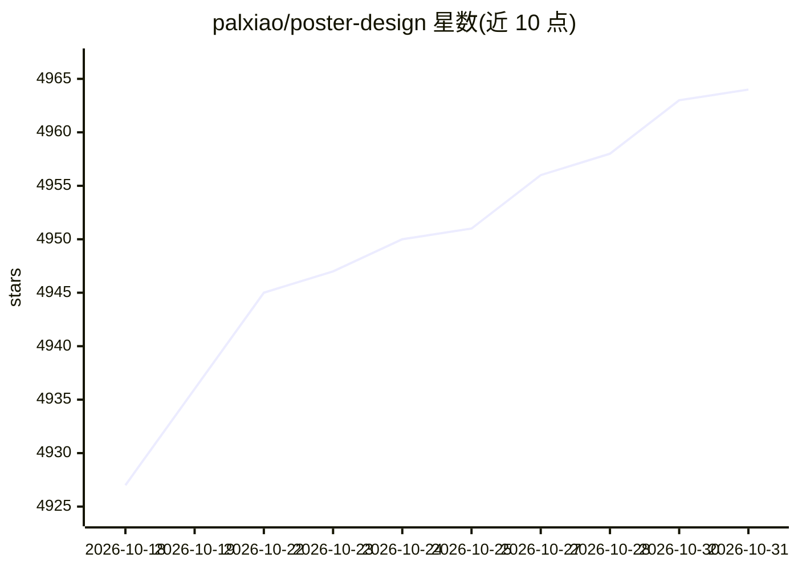

# palxiao/poster-design

⭐ 4,964 · Vue · AGPL-3.0 · 推送 2026-09-10 · [GitHub](https://github.com/palxiao/poster-design) · [官网](https://design.palxp.cn) · 个人维护 · 中文 README

**开源在线海报/图片设计器，内置 AI 生图、文案与抠图**

基于 Vue3 + Node.js/Express 的自部署在线图片设计器：原生 DOM 画布编辑器配合 Puppeteer（后端）与 Html2canvas（前端）出图，内嵌 SQLite 存储，附管理后台与接口，覆盖模板/素材/字体/用户/作品管理。AI 能力包括后台可配置的 OpenAI 格式接口生图与文案（默认智谱）、浏览器端 rembg 抠图（onnxruntime-web + u2netp）、PSD 解析辅助生成模板。面向个人开发者自部署与二次开发，另有付费企业版「迅排 Plus」提供私有化交付。AGPL-3.0 协议。

## 筛选速览

| 维度 | 判定 | 备注 |
|---|---|---|
| AI 角色 | `ai-enhanced` | 去掉 AI 部分产品仍成立 |
| 许可风险 | `viral` | AGPL-3.0 |
| 部署形态 | `None` |  |
| 模型依赖 | — | README 未给出锁定关系 |
| 硬件要求 | — | 无带数字的原话,不猜 |
| 安装摩擦 | `low` | 无编译、无系统依赖或容器化 |
| 成熟度 | — | 结构信号不足 |

## 能力要点

- 原生 DOM 画布编辑 + Puppeteer/Html2canvas 前后端混合出图
- 内置免费 AI 生图与文案（兼容任意 OpenAI 格式接口，后台可配置）
- 浏览器端 AI 抠图（onnxruntime-web + u2netp 约 4.7MB），无需部署
- 支持导入 PSD 解析辅助生成模板，附完整管理后台

## 适用场景

- 自部署一个海报/电商图/公众号封面的在线设计站点
- 利用 AI 生图、文案与一键抠图快速产出设计图
- 将 PSD 设计稿转成可编辑网页模板

## 场景标签

`AI 写作` `图像生成` `图像视频处理` · 领域:内容生成

## 证据(README 行号)

> L8: 一个开箱即用、可零开发部署生产的开源 AI 海报设计器 / 在线图片设计工具：原生 DOM 画布编辑器，前端与服务端混合出图，附完整后台管理与接口，简洁好用、易于开发。
> L22: |内置免费 AI 生图、文案|AI 抠图，无需部署|
> L195: 7. AI 配置：兼容任意 OpenAI 格式接口（默认智谱开放平台），可在后台配置接口地址、API Key、文案/生图模型与生图尺寸档位，并在线测试连通性。

## 星数曲线

2026-10-18 4,927 → 2026-10-31 4,964（+37）

---
*卡片 v1 · prompt 1.4 · 生成 2026-10-20 · 置信度 high · 依据 README sha `dc31d2ee5dcf` · [字段定义](../../DATASET.md)*
