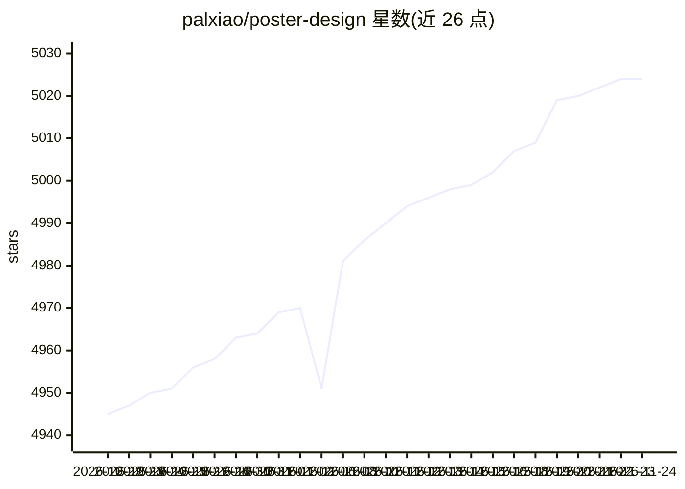

# palxiao/poster-design

⭐ 5,024 · Vue · AGPL-3.0 · 推送 2026-11-18 · [GitHub](https://github.com/palxiao/poster-design) · [官网](https://design.palxp.cn) · 个人维护 · 中文 README

**给需要在线设计海报的用户的开源自部署图片编辑器**

开源在线图片设计工具：前端为原生 DOM 画布编辑器（Vue3/Vite5/Pinia/TypeScript），后端 Node.js + Express 提供模板/素材/用户作品管理与接口，内嵌 SQLite 存储，通过 Puppeteer 服务端合成图片。内置免费 AI 生图、文案生成与浏览器端 AI 抠图（onnxruntime-web + u2netp 模型），后台可配置任意 OpenAI 格式接口。支持 PSD 文件解析辅助生成模板。面向海报、电商图、文章长图、视频/公众号封面等场景，自部署开箱即用。

## 筛选速览

| 维度 | 判定 | 备注 |
|---|---|---|
| AI 角色 | `ai-enhanced` | 去掉 AI 部分产品仍成立 |
| 许可风险 | `viral` | AGPL-3.0 |
| 部署形态 | `None` |  |
| 模型依赖 | — | README 未给出锁定关系 |
| 硬件要求 | — | 无带数字的原话,不猜 |
| 安装摩擦 | `low` | 无编译、无系统依赖或容器化 |
| 成熟度 | — | 结构信号不足 |

## 能力要点

- 原生 DOM 画布编辑器，支持 PSD 解析辅助生成模板
- 内置 AI 生图、文案与浏览器端 AI 抠图（onnxruntime-web + u2netp）
- 完整后台管理：模板/素材/字体/分类/用户与管理员鉴权
- Puppeteer 服务端出图与 Html2canvas 前端出图

## 适用场景

- 在线生成海报、电商产品图与公众号封面
- 解析 PSD 设计稿还原并辅助制作模板
- 自部署带后台管理的图片设计站点

## 场景标签

`AI 写作` · 领域:内容生成

## 证据(README 行号)

> L8: 一个开箱即用、可零开发部署生产的开源 AI 海报设计器 / 在线图片设计工具：原生 DOM 画布编辑器，前端与服务端混合出图，附完整后台管理与接口，简洁好用、易于开发。
> L14: 全新开源版 2.0 增加了免费的 AI 功能，且相比旧版拥有完整的后台管理与接口，真正做到开箱即用，旧版请访问 mit-version 分支。
> L32: - 主要技术栈与框架：Vue3 、Vite5 、Pinia 、TypeScript，Node.js + Express + ElementPlus

## 星数曲线

2026-10-22 4,945 → 2026-11-24 5,024（+79）

---
*卡片 v1 · prompt 1.4 · 生成 2026-11-22 · 置信度 high · 依据 README sha `01c8166ce658` · [字段定义](../../DATASET.md)*
