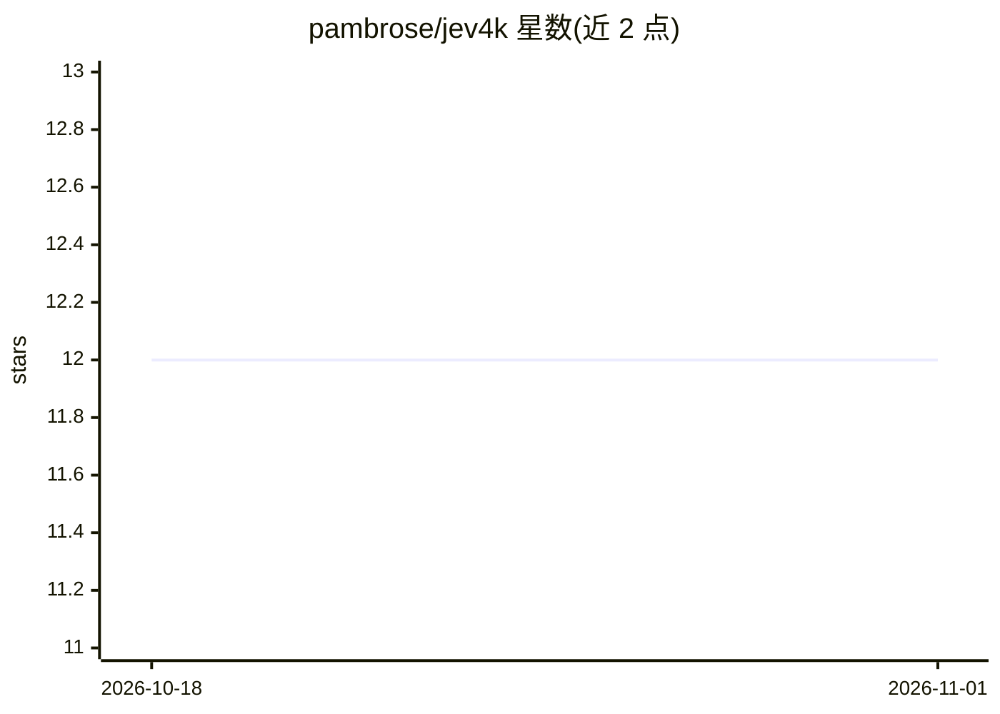

# pambrose/jev4k

⭐ 12 · Kotlin · Apache-2.0 · 推送 2026-10-25 · [GitHub](https://github.com/pambrose/jev4k) · [官网](https://jev4k.com) · 个人维护

**面向 TypeSafe Jev 模型的 Kotlin 多平台 DSL 与客户端**

jev4k 是访问 TypeSafe Jev 模型的 Kotlin Multiplatform 库：开发者用 DSL 声明类型化问题（Noul/Choice/Score，实验性 Box），随状态（文本、JSON 或 @Serializable 对象，实验性支持图片）一次请求发出，取回带校准概率的类型化答案（enum 选项、置信度、阈值判断等辅助方法）。覆盖 JVM（Java 17 字节码）、Apple 平台、Linux、Windows 与 Node.js，各平台共用同一 common 代码、仅 HTTP 引擎不同。限制：JVM 之外无阻塞调用，Linux Curl 引擎需系统 CA 证书，浏览器端不应直连（会泄露 API key），Choice 最多 255 个选项、Score 2-10 级。经 Maven Central 分发。

## 筛选速览

| 维度 | 判定 | 备注 |
|---|---|---|
| AI 角色 | `ai-ecosystem` | LLM/agent 周边工具 |
| 许可风险 | `permissive` | Apache-2.0 |
| 部署形态 | `None` |  |
| 模型依赖 | — | README 未给出锁定关系 |
| 硬件要求 | — | 无带数字的原话,不猜 |
| 安装摩擦 | `medium` | 含编译或系统依赖之一 |
| 成熟度 | `idea` | |

## 能力要点

- 三种类型化问题（Noul/Choice/Score）与实验性 Box 图像定位
- 一次请求并行回答全部问题，答案为带校准概率的类型化值
- 同一 common 代码支持 JVM/Apple/Linux/Windows/Node.js 多平台
- 发送前本地校验（选项数、嵌套深度等）并汇总为单一异常

## 适用场景

- 在 Kotlin/Java 项目中对消息或文档做类型化分类与判分
- 用 enum 选项让模型输出可直接分支的枚举答案
- 跨平台（含 iOS/Linux/Node.js）复用同一套 Jev 查询定义

## 场景标签

 · 领域:LLM 客户端/开发库

## 证据(README 行号)

> L12: A Kotlin Multiplatform DSL and client for TypeSafe's **Jev** model, for the JVM, Apple
> L16: set of typed **questions**, and it returns typed **answers** with calibrated probabilities that your code can branc
> L17: sort by, and threshold. jev4k lets you declare those questions in Kotlin, send them in one request, and read the an

## 星数曲线

2026-10-18 12 → 2026-11-01 12（+0）

---
*卡片 v1 · prompt 1.4 · 生成 2026-11-01 · 置信度 high · 依据 README sha `f9c00e65e20c` · [字段定义](../../DATASET.md)*
