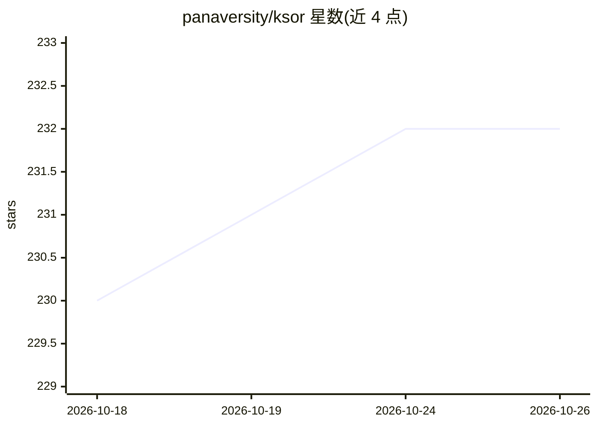

# panaversity/ksor

⭐ 232 · TypeScript · Apache-2.0 · 推送 2026-10-01 · [GitHub](https://github.com/panaversity/ksor) · [官网](https://ksor.panaversity.org/) · 组织维护

**构建受治理权威知识记录的开源框架，供人与 AI agent 共用**

KSoR 是一个 vendor-neutral 的知识基础设施 SDK，面向企业和教育机构，用一份受治理的权威知识记录（政策、规程、课程、评分标准等）供人类和 AI agent 使用。机制上以 Markdown 编写知识，经治理边界控制版本、审批、受众与可见性，draft 文档在人工批准前不会进入 agent 可读的机器表面（llms.txt 等）；后续可加 Postgres 与 embedding key，通过 provision/refresh/serve 向 agent 提供查询。限制：需要 Node 24 或更新版本。

## 筛选速览

| 维度 | 判定 | 备注 |
|---|---|---|
| AI 角色 | `ai-ecosystem` | LLM/agent 周边工具 |
| 许可风险 | `permissive` | Apache-2.0 |
| 部署形态 | `library` | 以包/库形式分发 |
| 模型依赖 | — | README 未给出锁定关系 |
| 硬件要求 | — | 无带数字的原话,不猜 |
| 安装摩擦 | `low` | 无编译、无系统依赖或容器化 |
| 成熟度 | — | 结构信号不足 |

## 能力要点

- 治理边界控制版本、审批人、受众与可见性，draft 文档未经人工批准不进入任何 agent 读取面
- 一条权威记录通过多种开放投影（含 llms.txt、markdown twins）供人、agent 与机器使用
- 以 npx/pnpm/bun 一条命令初始化项目，产出普通可自有的网站工程（构建时无下载、不回传）
- 支持 abstention：知识不足时系统拒绝而非即兴编造

## 适用场景

- 让企业 agent 基于同一份受治理的制度与规程知识运行
- 让教育机构的 AI 助教与评测 agent 基于同一份课程权威记录教学
- 把散落在文档、wiki、PDF 中的知识收敛为带版本与审批的单一记录

## 场景标签

`知识库管理` · 领域:知识与检索

## 证据(README 行号)

> L15: A **Knowledge System of Record (KSoR)** solves that problem by giving an organization **one governed, authoritative
> L60: > **KSoR is an open knowledge infrastructure framework that makes governed knowledge usable by people, AI agents, a

## 星数曲线

2026-10-18 230 → 2026-10-26 232（+2）

---
*卡片 v1 · prompt 1.4 · 生成 2026-10-22 · 置信度 high · 依据 README sha `a1300c8acc0a` · [字段定义](../../DATASET.md)*
