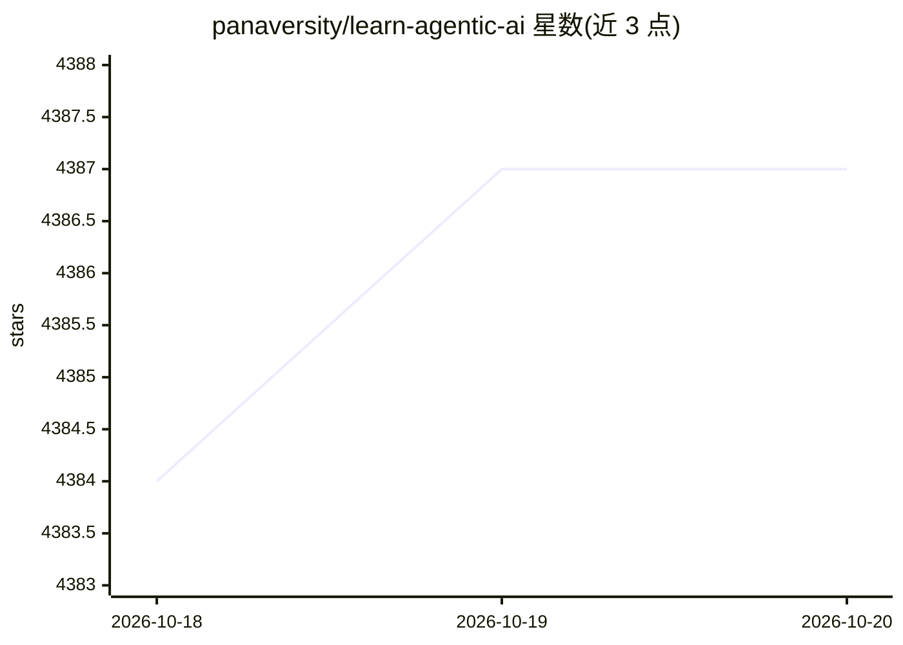

# panaversity/learn-agentic-ai

⭐ 4,387 · Jupyter Notebook · MIT · 推送 2025-10-26 · [GitHub](https://github.com/panaversity/learn-agentic-ai) · 组织维护

**Agentic AI 与云原生课程资料库：DACA 设计模式与相关技术教学**

Panaversity 认证课程的配套学习仓库，围绕自创的 Dapr Agentic Cloud Ascent (DACA) 设计模式组织 Agentic AI 教学内容：提出四个假设（Agentic AI 趋势、Kubernetes×Dapr×Ray 云原生栈、学习差距、MCP/A2A/NANDA 协议化的可互操作 Web），并以较长篇幅论证 Dapr+Kubernetes 支撑千万级并发代理的可行性（引用公开基准与案例做外推）。涉及 OpenAI Agents SDK、MCP、A2A、记忆、知识图谱等技术栈，含框架对比表。给 Agentic AI 开发者与 AgentOps 学习者使用。

## 筛选速览

| 维度 | 判定 | 备注 |
|---|---|---|
| AI 角色 | `ai-knowledge` | 知识聚合/清单类 |
| 许可风险 | `permissive` | MIT |
| 部署形态 | `None` |  |
| 模型依赖 | — | README 未给出锁定关系 |
| 硬件要求 | — | 无带数字的原话,不猜 |
| 安装摩擦 | `low` | 无编译、无系统依赖或容器化 |
| 成熟度 | — | 结构信号不足 |

## 能力要点

- 提出 DACA 设计模式：OpenAI Agents SDK + MCP + A2A + Dapr 的组合
- 四假设战略文档：云原生栈、协议化 Web、学习差距分析
- Dapr+Kubernetes 支撑 1000 万并发代理的可行性论证（含低预算方案）
- 六种代理框架抽象层对比表（OpenAI Agents SDK/CrewAI/AutoGen 等）

## 适用场景

- 系统学习 Agentic AI 与云原生部署的课程材料
- 了解 DACA 设计模式及其技术选型理由
- 比较大模型代理框架的抽象层级

## 场景标签

`教程课程` · 领域:学习与行业

## 证据(README 行号)

> L3: This repo is part of the Panaversity Certified Agentic & Robotic AI Engineer program. You can also review the certif
> L76: Let's understand and learn about "Dapr Agentic Cloud Ascent (DACA)", our winning design pattern for developing and 

## 星数曲线

2026-10-18 4,384 → 2026-10-20 4,387（+3）

---
*卡片 v1 · prompt 1.4 · 生成 2026-10-20 · 置信度 high · 依据 README sha `a4667b411101` · [字段定义](../../DATASET.md)*
