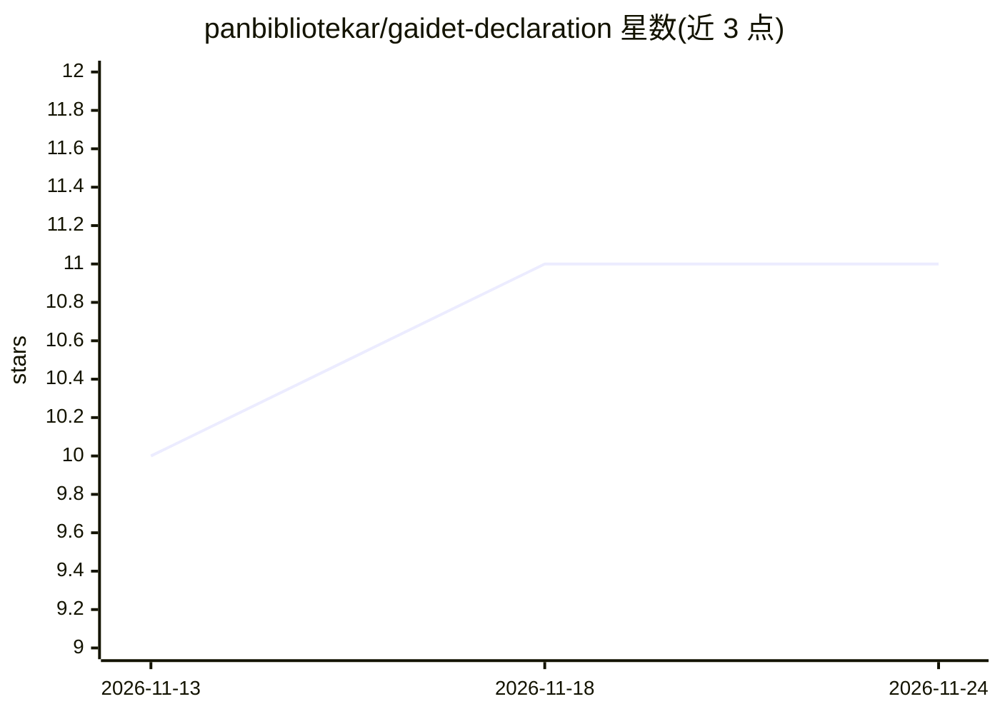

# panbibliotekar/gaidet-declaration

⭐ 11 · HTML · NOASSERTION · 推送 2026-09-29 · [GitHub](https://github.com/panbibliotekar/gaidet-declaration) · [官网](https://w3id.org/gaidet/) · 个人维护

**帮研究者生成论文中生成式 AI 使用声明的 HTML 工具**

基于 GAIDeT（生成式 AI 委托分类法）的交互式 HTML 工具：研究者填写责任作者、所用 LLM 版本，勾选委托给 AI 的研究与写作任务，可选附注释，一键生成可粘贴到 Methods、Acknowledgments 或 CRediT 部分的声明文本。配套提供 OWL 本体与 YAML 术语表，所有术语可解析为 w3id.org URI。工具为 beta 版，尚在公开前征集反馈，声明排版建议紧随 CRediT 部分以区分人类与 AI 贡献。

## 筛选速览

| 维度 | 判定 | 备注 |
|---|---|---|
| AI 角色 | `ai-knowledge` | 知识聚合/清单类 |
| 许可风险 | `none` | NOASSERTION |
| 部署形态 | `None` |  |
| 模型依赖 | — | README 未给出锁定关系 |
| 硬件要求 | — | 无带数字的原话,不猜 |
| 安装摩擦 | `low` | 无编译、无系统依赖或容器化 |
| 成熟度 | `idea` | |

## 能力要点

- 基于 GAIDeT 分类法的任务勾选式声明生成
- 术语以 OWL/YAML 发布，URI 可解析（w3id.org）
- 纯 HTML 交互工具，生成文本可复制进稿件

## 适用场景

- 为投稿论文撰写生成式 AI 使用披露声明
- 在 CRediT 部分之外单独附 AI 委托说明
- 按分类法盘点研究中哪些任务委托给了 LLM

## 场景标签

`科研工具` `AI 写作` · 领域:内容生成

## 证据(README 行号)

> L5: The GAIDeT Declaration Generator is an interactive HTML tool that helps researchers transparently disclose the use o
> L30: 3. Select the relevant research and writing tasks

## 星数曲线

2026-11-13 10 → 2026-11-24 11（+1）

---
*卡片 v1 · prompt 1.4 · 生成 2026-11-18 · 置信度 high · 依据 README sha `49e7055e7736` · [字段定义](../../DATASET.md)*
