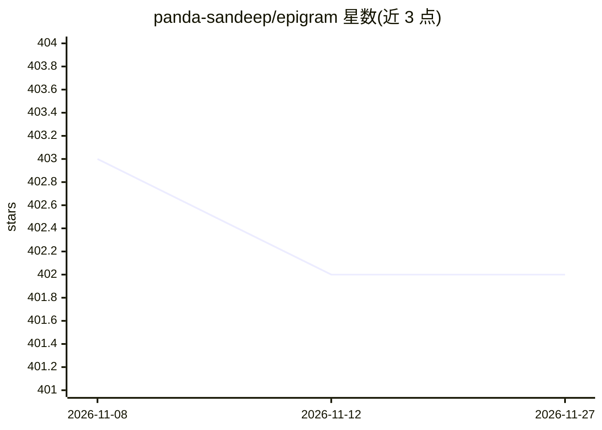

# panda-sandeep/epigram

⭐ 402 · TypeScript · AGPL-3.0 · 推送 2026-10-25 · [GitHub](https://github.com/panda-sandeep/epigram) · [官网](https://epigram.news) · 个人维护

**开源 AI 新闻摘要应用：为读者提供个性化解的新闻简报**

基于 Next.js 的开源新闻阅读应用：从 Mediastack 等来源获取新闻，用 AI 生成简短摘要与深度分析（gpt-4o-mini），按用户兴趣提供个性化订阅流，支持 PWA 添加到主屏幕。面向希望快速了解新闻的普通读者，可自行部署（需 Node.js 20+ 与 Mediastack/Exa/OpenAI API key），部署到 Cloud Run/Vercel 等平台并配置 cron 定时抓取新闻。采用 AGPL-3.0 许可。

## 筛选速览

| 维度 | 判定 | 备注 |
|---|---|---|
| AI 角色 | `ai-native` | 本体是模型或模型工具 |
| 许可风险 | `viral` | AGPL-3.0 |
| 部署形态 | `library` | 以包/库形式分发 |
| 模型依赖 | — | README 未给出锁定关系 |
| 硬件要求 | — | 无带数字的原话,不猜 |
| 安装摩擦 | `low` | 无编译、无系统依赖或容器化 |
| 成熟度 | — | 结构信号不足 |

## 能力要点

- AI 生成新闻摘要与文章深度分析（gpt-4o-mini）
- 基于用户兴趣的个性化新闻流
- 响应式设计并支持 PWA 添加到主屏幕
- 可部署至任何支持 Next.js 的平台

## 适用场景

- 快速获取可信来源新闻的 AI 摘要
- 按兴趣定制个人新闻阅读流
- 自部署一套开源新闻简报服务

## 场景标签

`AI 写作` · 领域:内容生成

## 证据(README 行号)

> L30: - 🤖 **AI-powered Summaries** - Get concise news summaries and in-depth analysis
> L41: - AI SDK & OpenAI - AI analysis with `gpt-4o-mini`

## 星数曲线

2026-11-08 403 → 2026-11-27 402（-1）

---
*卡片 v1 · prompt 1.4 · 生成 2026-11-17 · 置信度 high · 依据 README sha `b3109e82a5b9` · [字段定义](../../DATASET.md)*
