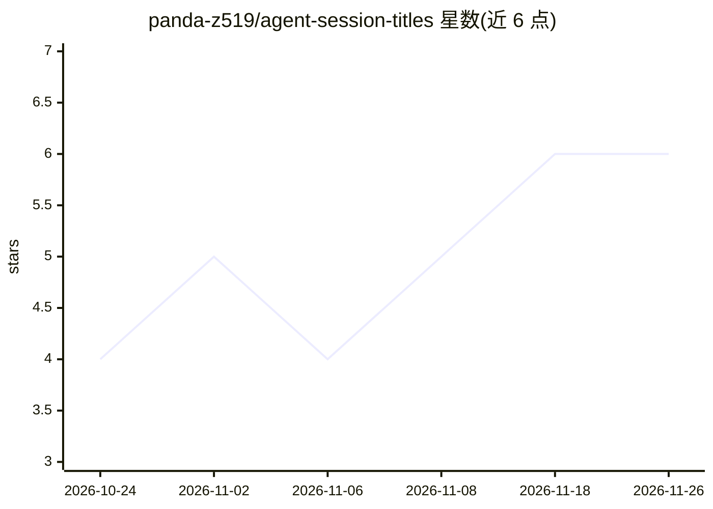

# panda-z519/agent-session-titles

⭐ 6 · Python · MIT · 推送 2026-11-01 · [GitHub](https://github.com/panda-z519/agent-session-titles) · 个人维护 · 中文 README

**为 Codex/Claude Code/DeepSeek Harness 安装会话标题自动更新插件的安装器**

通过 npx 一条命令为本地 Codex、Claude Code 与 DeepSeek Harness 客户端安装会话标题插件，维护「状态｜初始需求｜当前进展」三段式标题，支持中英文与九个自动状态词。机制上通过注册各客户端的钩子/插件实现：Codex 调用 thread/name/set 或写 SQLite，Claude Code 走官方 sessionTitle 钩子，DSH 由宿主 sessionTitle 服务写入。支持手动锁定单段、旧钩子迁移备份、全局规则文件托管块写入与卸载。限制：依赖各客户端内部接口与钩子机制，仅支持 macOS/Linux。

## 筛选速览

| 维度 | 判定 | 备注 |
|---|---|---|
| AI 角色 | `ai-ecosystem` | LLM/agent 周边工具 |
| 许可风险 | `permissive` | MIT |
| 部署形态 | `library` | 以包/库形式分发 |
| 模型依赖 | — | README 未给出锁定关系 |
| 硬件要求 | — | 无带数字的原话,不猜 |
| 安装摩擦 | `low` | 无编译、无系统依赖或容器化 |
| 成熟度 | — | 结构信号不足 |

## 能力要点

- 一条 npx 命令安装到 Codex/Claude Code/DSH 三端，支持按端选择
- 三段式标题（状态｜初始需求｜进展），手动修改的段落自动锁定
- 旧版钩子迁移备份、全局 AGENTS.md/CLAUDE.md 托管块管理、可重复安装与卸载
- 支持自定义配置目录 CODEX_HOME/CLAUDE_CONFIG_DIR/DSH_HOME

## 适用场景

- 让 Codex CLI 窗口标题随开发阶段实时刷新
- 为多个并行会话快速辨认各自的任务和进度
- 迁移旧版独立标题钩子到插件化方案

## 场景标签

`编码 Agent` · 领域:编码与开发

## 证据(README 行号)

> L7: 为 **Codex**、**Claude Code** 和 **DeepSeek Harness** 的本地会话维护可选中文或英文的三段式标题：
> L135: |Codex|注册并安装 `codex-session-titles` 插件；把 `~/.codex/session-titles/` 加入窄范围可写目录；更新前检查状态库结构并创建 SQLite 一致性备份。|
> L146: 4. Claude Code 首条提示词通过官方 `sessionTitle` 钩子输出形成初始标题。**桌面端**在 Agent 写入标题文件后由 `PostToolUse` 钩子调用桌面端改名工具**立即**生效；**命令行

## 星数曲线

2026-10-24 4 → 2026-11-26 6（+2）

---
*卡片 v1 · prompt 1.4 · 生成 2026-11-20 · 置信度 high · 依据 README sha `1ed55da888a6` · [字段定义](../../DATASET.md)*
