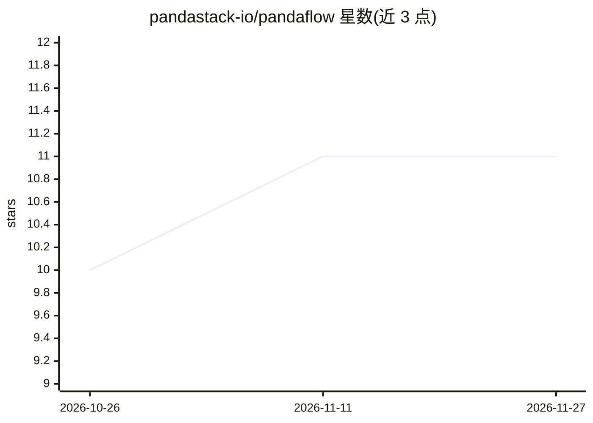

# pandastack-io/pandaflow

⭐ 11 · TypeScript · MIT · 推送 2026-08-13 · [GitHub](https://github.com/pandastack-io/pandaflow) · [官网](https://pandastack.ai) · 组织维护

**AI agent 可视化工作流构建器：拖拽编排 LLM/数据库/API/代码节点**

PandaFlow 是开源的 AI agent 可视化工作流构建平台：在 React Flow 拖拽画布上连接 LLM、数据库、API、webhook 与代码执行等 160+ 节点，构建和编排 agent 工作流。代码节点在 PandaStack 隔离 microVM 沙箱中运行（Python/Node.js/Go/Bash，含 Playwright 浏览器自动化），每次执行创建临时沙箱并在结束后自动清理；提供 SSE 实时执行监控、按组织加密的密钥管理与多节点工作流模板。技术栈为 Next.js 16 + PostgreSQL 16 + Redis 7，MIT 许可，可自托管或部署到 PandaStack 云。

## 筛选速览

| 维度 | 判定 | 备注 |
|---|---|---|
| AI 角色 | `ai-ecosystem` | LLM/agent 周边工具 |
| 许可风险 | `permissive` | MIT |
| 部署形态 | `None` |  |
| 模型依赖 | — | README 未给出锁定关系 |
| 硬件要求 | — | 无带数字的原话,不猜 |
| 安装摩擦 | `low` | 无编译、无系统依赖或容器化 |
| 成熟度 | — | 结构信号不足 |

## 能力要点

- React Flow 拖拽画布，160+ 节点（LLM、数据库、API、webhook 等）
- PandaStack 隔离 microVM 执行代码与浏览器自动化，临时沙箱自动清理
- Server-Sent Events 实时执行监控
- 支持自定义节点扩展与预置工作流模板

## 适用场景

- 拖拽搭建多节点 AI agent 工作流
- 在隔离沙箱中执行工作流里的代码与浏览器自动化任务
- 自托管部署并通过 SSE 监控工作流执行

## 场景标签

`工作流自动化` `Agent 框架` · 领域:Agent 开发

## 证据(README 行号)

> L3: > Open source AI agent visual workflow builder by PandastackIO Inc.
> L8: Build, deploy, and orchestrate AI agents visually. Connect LLMs, databases, APIs, and code execution nodes on a drag

## 星数曲线

2026-10-26 10 → 2026-11-27 11（+1）

---
*卡片 v1 · prompt 1.4 · 生成 2026-11-18 · 置信度 high · 依据 README sha `b60bcb2cc25e` · [字段定义](../../DATASET.md)*
