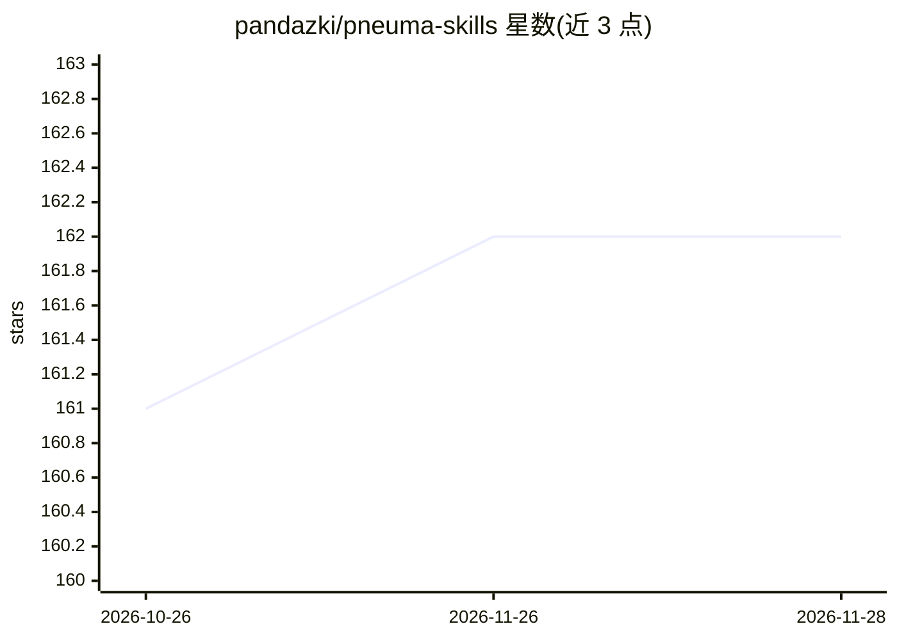

# pandazki/pneuma-skills

⭐ 162 · TypeScript · MIT · 推送 2026-11-23 · [GitHub](https://github.com/pandazki/pneuma-skills) · 个人维护 · 中文 README

**人类与代码代理共创内容的可视化环境与技能分发平台**

构建在主流代码代理（Claude Code、Codex、Kimi Code）之上的共创基础设施：代理直接在磁盘文件中工作，Pneuma 提供按领域渲染的可视化播放器（幻灯片、画布、项目板），人类可在 UI 中直接编辑或提交结构化建议。核心机制为四大支柱：可视化环境、按模式注入的领域技能与持久会话、跨会话持续学习（Evolution Agent 提议技能增删）、通过 Mode Maker 制作并发布到市场分发。内置 20+ 模式覆盖网页、视频、排版、幻灯片、插画、动画等。图像/视频/语音工具需配置 OpenRouter 或 fal.ai 密钥。

## 筛选速览

| 维度 | 判定 | 备注 |
|---|---|---|
| AI 角色 | `ai-native` | 本体是模型或模型工具 |
| 许可风险 | `permissive` | MIT |
| 部署形态 | `desktop` | 安装包/桌面程序 |
| 模型依赖 | — | README 未给出锁定关系 |
| 硬件要求 | — | 无带数字的原话,不猜 |
| 安装摩擦 | `low` | 无编译、无系统依赖或容器化 |
| 成熟度 | — | 结构信号不足 |

## 能力要点

- 四大支柱：可视化环境、技能注入、持续学习、模式分发
- 内置 20+ 模式：网页开发、视频制作、幻灯片、插画、品牌、板书讲解等
- 会话持久化，代理可跨运行接续工作
- Mode Maker 用 AI 创建自定义模式并发布到市场

## 适用场景

- 和代码代理一起制作幻灯片、网页、视频等内容
- 让代理生成贴纸、动画素材并导出为微信/Telegram/LINE 格式
- 搭建并分享自定义创作模式

## 场景标签

`Agent 框架` · 领域:Agent 开发

## 证据(README 行号)

> L40: When humans and code agents co-create content, they need more than a chat window — they need shared infrastructure.
> L53: |**webcraft**|Live web development with Impeccable AI design intelligence — 22 design commands, four visitor modes,

## 星数曲线

2026-10-26 161 → 2026-11-28 162（+1）

---
*卡片 v1 · prompt 1.4 · 生成 2026-11-27 · 置信度 high · 依据 README sha `abe1d9aa58e4` · [字段定义](../../DATASET.md)*
