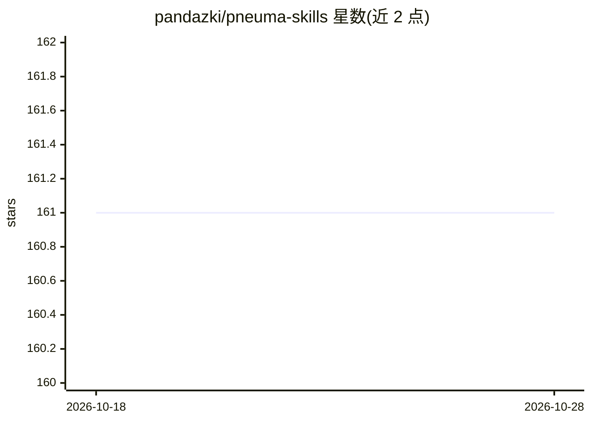

# pandazki/pneuma-skills

⭐ 161 · TypeScript · MIT · 推送 2026-10-27 · [GitHub](https://github.com/pandazki/pneuma-skills) · 个人维护 · 中文 README

**人与代码 agent 协作的内容创作基础设施，含可视化环境与技能模式**

面向开发者与内容创作者的协作基础设施：以磁盘文件为 agent 的工作面，为每个任务提供按领域渲染的实时查看器（幻灯片、画板、图表等），人类可直接插入编辑或结构化建议。会话可跨运行持久化，持久偏好跨会话携带，Evolution Agent 提出技能指引的增删建议供人工审阅。启动会话时在 Claude Code、Codex、Kimi Code 三种后端中选择，各后端经共享运行时提供能力；内置 20 个模式（幻灯片、排版、视频、图解等），支持 Mode Maker 创建并发布自定义模式到市场。提供桌面安装包（内置 Bun）与 CLI，源码运行需 Bun ≥1.3.14 及至少一个 agent CLI；图像工具需 OpenRouter API key，视频/语音等工具可能需 fal.ai key。

## 筛选速览

| 维度 | 判定 | 备注 |
|---|---|---|
| AI 角色 | `ai-ecosystem` | LLM/agent 周边工具 |
| 许可风险 | `permissive` | MIT |
| 部署形态 | `desktop` | 安装包/桌面程序 |
| 模型依赖 | locked-api |  |
| 硬件要求 | — | 无带数字的原话,不猜 |
| 安装摩擦 | `low` | 无编译、无系统依赖或容器化 |
| 成熟度 | — | 结构信号不足 |

## 能力要点

- 以磁盘文件为 agent 原生工作面，配按领域渲染的实时查看器
- 启动时选择 Claude Code / Codex / Kimi Code 后端，经共享运行时提供能力
- 内置 20 个模式（slide/kami/clipcraft/wordtaste 等），各自独立版本
- Mode Maker 用 AI 创建自定义模式并发布到市场，`pneuma mode add` 分享

## 适用场景

- 与代码 agent 协作制作幻灯片、排版文档、图表或视频等内容
- 在 agent 工作过程中以可视化方式查看并适时介入编辑
- 跨会话积累偏好与技能，持续改进协作方式
- 创建并分发自定义工作模式给他人使用

## 场景标签

`AI 写作` · 领域:内容生成

## 证据(README 行号)

> L40: When humans and code agents co-create content, they need more than a chat window — they need shared infrastructure.
> L157: |**AgentBackend**|Launch, resume, kill, capability declaration|Other agents (Aider, etc.)|
> L161: - Process lifecycle: `AgentBackend` owns launch, resume, exit, and capability declaration.

## 星数曲线

2026-10-18 161 → 2026-10-28 161（+0）

---
*卡片 v1 · prompt 1.4 · 生成 2026-10-23 · 置信度 high · 依据 README sha `4bd529da7b17` · [字段定义](../../DATASET.md)*
