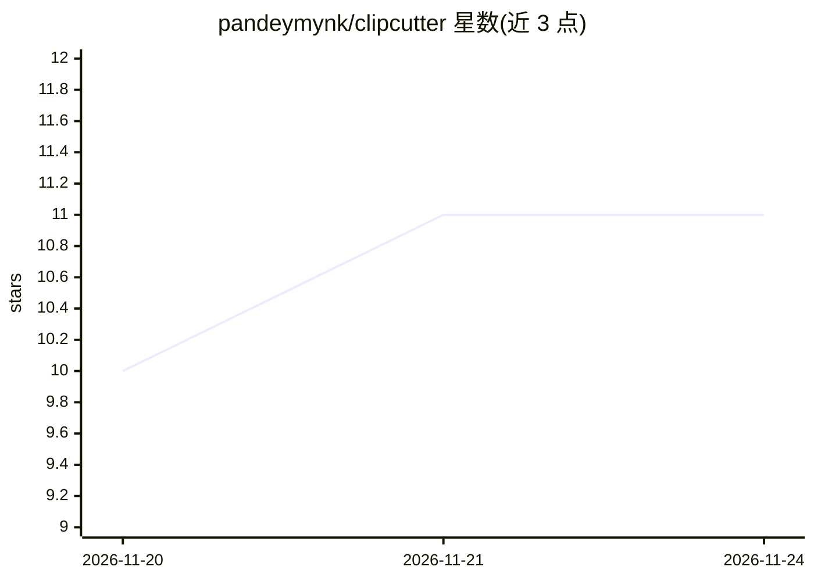

# pandeymynk/clipcutter

⭐ 11 · Python · 推送 2026-11-22 · [GitHub](https://github.com/pandeymynk/clipcutter) · 个人维护

**本地运行的直播视频→9:16 竖版剪辑自动生成工具**

输入 YouTube/Twitch/Kick 链接或本地视频，下载后通过平台字幕或本地 Whisper 转写，按响度峰值、弹幕刷屏、口头禅等信号为每一秒打分选出高光时刻，用 ffmpeg 渲染成带前置 hook 与逐词字幕的 1080×1920 竖版 MP4，并生成标题、文案与话题标签。默认用模板写 hook，可配置 Claude 或本地 Ollama 模型。以 Web 服务、命令行与多用户站点三种形态运行，全部在本地执行。

## 筛选速览

| 维度 | 判定 | 备注 |
|---|---|---|
| AI 角色 | `ai-native` | 本体是模型或模型工具 |
| 许可风险 | `none` | — |
| 部署形态 | `None` |  |
| 模型依赖 | local-ok | 支持本地模型 |
| 硬件要求 | — | 无带数字的原话,不猜 |
| 安装摩擦 | `medium` | 含编译或系统依赖之一 |
| 成熟度 | — | 结构信号不足 |

## 能力要点

- 基于响度/弹幕/语音/画面信号的高光时刻检测与 0–99 传播分
- 平台字幕优先免转写，缺字幕时用 Whisper 本地语音转文字
- hook（~2.5 秒放大师焦段）+ 主体 + Gen Z 逐词字幕的渲染管线（ffmpeg）
- 创作者跟踪：新视频自动剪辑，支持 24 小时长播按 most-replayed 只下载片段

## 适用场景

- 把自己直播或授权的录像一键切成 TikTok/Shorts/Reels 竖版短片
- 跟踪喜欢的频道，新视频自动出剪辑
- 为 Hindi/Hinglish 内容生成天城文与混语字幕

## 场景标签

`图像视频处理` · 领域:感知与多模态

## 证据(README 行号)

> L3: **Any video or stream → viral 9:16 clips, automatically.** Paste a YouTube, Twitch or Kick link. ClipCutter
> L65: 1. **Download** the video and its captions (or chat replay) with yt-dlp.
> L69: 5. **Render** with ffmpeg: hook segment + main segment + layout + caption overlay + sound + loudness.

## 星数曲线

2026-11-20 10 → 2026-11-24 11（+1）

---
*卡片 v1 · prompt 1.4 · 生成 2026-11-20 · 置信度 high · 依据 README sha `7da1a4ec1459` · [字段定义](../../DATASET.md)*
