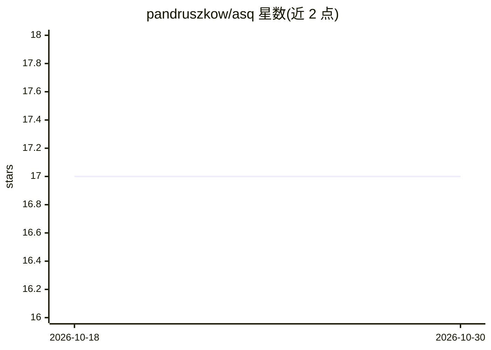

# pandruszkow/asq

⭐ 17 · Python · GPL-3.0 · 推送 2026-08-10 · [GitHub](https://github.com/pandruszkow/asq) · 个人维护

**面向开发者的 Chat Completions API 命令行问答助手**

Asq 是一个围绕 OpenAI Chat Completions 兼容 API 的命令行封装工具，供开发者在终端提问获取简短回答。默认请求发往 Chutes.AI，可通过环境变量切换到 OpenRouter、llama.cpp 的 llama-server、litellm 代理或任意兼容端点。内置 DevOps/Python/AWS 预设知识方向，可自定义修改。提供 /power 模型切换、/reset 清空日志、/source 注入自身源码等斜杠命令，支持多行输入。当前无会话记忆（无状态），安装方式为 Docker 构建。

## 筛选速览

| 维度 | 判定 | 备注 |
|---|---|---|
| AI 角色 | `ai-native` | 本体是模型或模型工具 |
| 许可风险 | `viral` | GPL-3.0 |
| 部署形态 | `self-host` | docker 或自建部署 |
| 模型依赖 | — | README 未给出锁定关系 |
| 硬件要求 | — | 无带数字的原话,不猜 |
| 安装摩擦 | `low` | 无编译、无系统依赖或容器化 |
| 成熟度 | `idea` | |

## 能力要点

- 兼容任意 OpenAI Chat Completions 端点（默认 Chutes.AI）
- /source 命令将自身源码注入上下文，便于让 LLM 协助改造 Asq
- /power 在高功耗与 turbo 模型间切换，/reset 清空日志节省 token
- 支持 /// 多行输入，可粘贴配置文件或代码片段

## 适用场景

- 在终端快速向 LLM 咨询 DevOps、Python、AWS 等技术问题
- 让 LLM 阅读自身源码并指导修改，定制专属领域助手
- 接入本地 llama.cpp 或第三方代理端点做命令行问答

## 场景标签

`AI 助手` · 领域:对话与助手

## 证据(README 行号)

> L5: Asq is a command-line wrapper around a OpenAI Chat Completions-compatible API of your choice, that keeps things simp
> L52: Now that Asq is configured, you can run it from the command line using `./asq` or `docker run -it asq` (depending o

## 星数曲线

2026-10-18 17 → 2026-10-30 17（+0）

---
*卡片 v1 · prompt 1.4 · 生成 2026-10-29 · 置信度 high · 依据 README sha `6b7e49dd360a` · [字段定义](../../DATASET.md)*
