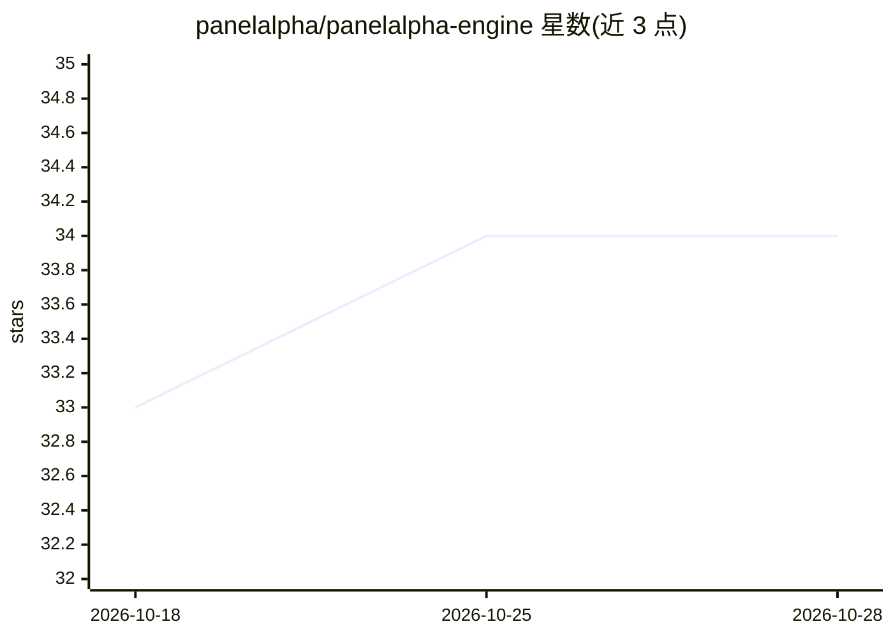

# panelalpha/panelalpha-engine

⭐ 34 · PHP · Apache-2.0 · 推送 2026-10-22 · [GitHub](https://github.com/panelalpha/panelalpha-engine) · [官网](https://engine.panelalpha.com/) · 组织维护

**自托管服务器引擎：让 AI agent 经 MCP 安全部署管理多个项目**

安装在 VPS 上的自托管引擎，通过 225 个 MCP 工具把部署与服务器管理暴露给用户自带的 AI 助手（Claude Code、Cursor、Codex 等），由 agent 完成部署、备份、域名 SSL、数据库、防火墙等操作；AI 不获得 root，经引擎内规则与权限（含只读 token）受限运行。项目以独立 Docker 容器隔离，支持 staging/live 环境、Cloudflare 集成与失败遥测。一行命令安装，要求 Debian 12/13 或 Ubuntu 22.04+ 的全新服务器、至少 2GB 内存。

## 筛选速览

| 维度 | 判定 | 备注 |
|---|---|---|
| AI 角色 | `ai-ecosystem` | LLM/agent 周边工具 |
| 许可风险 | `permissive` | Apache-2.0 |
| 部署形态 | `self-host` | docker 或自建部署 |
| 模型依赖 | — | README 未给出锁定关系 |
| 硬件要求 | — | 无带数字的原话,不猜 |
| 安装摩擦 | `low` | 无编译、无系统依赖或容器化 |
| 成熟度 | — | 结构信号不足 |

## 能力要点

- 225 个 MCP 工具，兼容 Claude Code、Cursor、Codex、Gemini CLI 等任意 MCP 助手
- AI 不获得 root，经引擎与可配置权限（含只读 token）执行操作
- 项目级 Docker 容器隔离，各自限制磁盘/内存/CPU 与开放端口
- 一行命令同时安装引擎并部署指定 Git 仓库

## 适用场景

- 让 AI 助手用自然语言在 VPS 上部署和运维多个项目
- 非系统管理员也能自托管 AI 生成或开源项目
- 通过 staging 环境先验证再推送到生产

## 场景标签

 · 领域:服务器管理/部署基础设施

## 证据(README 行号)

> L38: PanelAlpha Engine is software you install on your VPS to host AI-built and vibe-coded projects, websites and open s
> L118: Using something else? Any assistant that speaks MCP will work: connecting other assistants.

## 星数曲线

2026-10-18 33 → 2026-10-28 34（+1）

---
*卡片 v1 · prompt 1.4 · 生成 2026-10-25 · 置信度 mid · 依据 README sha `ce027c399d76` · [字段定义](../../DATASET.md)*
