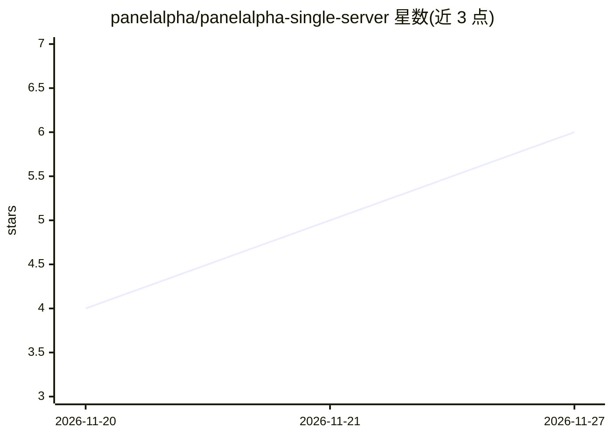

# panelalpha/panelalpha-single-server

⭐ 6 · TypeScript · Apache-2.0 · 推送 2026-11-19 · [GitHub](https://github.com/panelalpha/panelalpha-single-server) · [官网](https://www.panelalpha.com/documentation/single-server-edition/) · 组织维护

**自托管 VPS 的网站托管面板：WordPress、Git 部署、域名、备份与暂存**

安装在自有 VPS 上的 Web 托管面板，运行于 PanelAlpha Engine 之上，以引擎上一个容器化项目的形式存在，所有托管操作通过引擎 API 完成。浏览器内创建 WordPress 站点、从 Git/文件部署应用、管理域名与 Let's Encrypt 证书、手动或定时备份与恢复、暂存副本推送上线、数据库与 cron/FTP 管理。Community 版面向个人、无项目数限制，Apache 2.0 许可。要求 Debian 12/13 或 Ubuntu 22.04+、2GB 内存、80 端口开放，通过一条 shell 脚本安装。

## 筛选速览

| 维度 | 判定 | 备注 |
|---|---|---|
| AI 角色 | `ai-enhanced` | 去掉 AI 部分产品仍成立 |
| 许可风险 | `permissive` | Apache-2.0 |
| 部署形态 | `None` |  |
| 模型依赖 | — | README 未给出锁定关系 |
| 硬件要求 | — | 无带数字的原话,不猜 |
| 安装摩擦 | `low` | 无编译、无系统依赖或容器化 |
| 成熟度 | — | 结构信号不足 |

## 能力要点

- 浏览器内管理 WordPress、Git 应用、域名、备份与暂存（Push To Live）
- 通过 MCP 连接 Claude Code、ChatGPT、Cursor 等 AI 助手以对话方式管理项目
- 站点以独立容器隔离，移除面板不影响站点运行
- 可选连接 PanelAlpha Hub 实现统一登录与应用目录安装

## 适用场景

- 在自己的 VPS 上托管和管理多个 WordPress 站点
- 从 GitHub/GitLab/Bitbucket 推送自动部署应用
- 用暂存环境验证改动后再推到生产
- 通过 AI 助手对话执行列出项目、恢复备份等托管操作

## 场景标签

 · 领域:网站托管/运维工具

## 证据(README 行号)

> L35: PanelAlpha Single Server Edition is a web hosting panel you install on your own VPS. You open it in a browser and l
> L46: - Connect an AI assistant and manage your projects by chat
> L113: ## Connect your AI assistant

## 星数曲线

2026-11-20 4 → 2026-11-27 6（+2）

---
*卡片 v1 · prompt 1.4 · 生成 2026-11-21 · 置信度 high · 依据 README sha `4f7101a0d0c3` · [字段定义](../../DATASET.md)*
