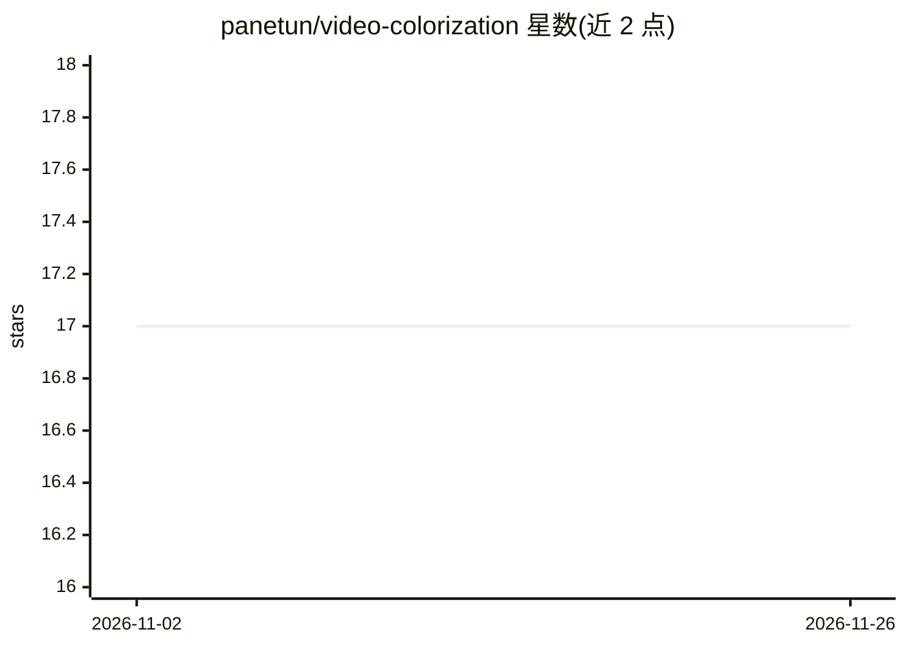

# panetun/video-colorization

⭐ 17 · Python · 推送 2026-11-01 · [GitHub](https://github.com/panetun/video-colorization) · 个人维护

**逐帧调用 DeOldify 为黑白视频上色的脚本工具**

在 DeOldify 深度学习图像上色工具之上封装的 shell 脚本：从 YouTube URL 下载视频、逐帧抽取并上色后合成输出，结果存放在 results 目录。输入目前仅支持 YouTube 链接，帧率为可选参数（默认 25），尚不支持本地 mp4 与 render_factor 调节（列入待实现）。运行需 CUDA GPU，GPU 显存决定可用质量；仅在 Ubuntu Mate 18.04 上测试过。作者已声明停更并将改动上游化到 DeOldify 项目。

## 筛选速览

| 维度 | 判定 | 备注 |
|---|---|---|
| AI 角色 | `ai-native` | 本体是模型或模型工具 |
| 许可风险 | `none` | — |
| 部署形态 | `None` |  |
| 模型依赖 | — | README 未给出锁定关系 |
| 硬件要求 | — | 无带数字的原话,不猜 |
| 安装摩擦 | `medium` | 含编译或系统依赖之一 |
| 成熟度 | — | 结构信号不足 |

## 能力要点

- 从 YouTube URL 下载视频并逐帧 DeOldify 上色
- 帧率可选参数（默认 25），输出到 results 目录
- 需要 CUDA GPU，GPU 显存限制结果质量

## 适用场景

- 为老黑白影片批量生成彩色版本
- 用不同 render_factor 试验上色效果（需改脚本）

## 场景标签

`图像视频处理` · 领域:感知与多模态

## 证据(README 行号)

> L3: jantic has created the awesome tool DeOldify that is colorizing images based on Deep Learning, and **this is an atte
> L13: * Converting a video using machine learning requires some heavy lifting, which means in this case that your machine

## 星数曲线

2026-11-02 17 → 2026-11-26 17（+0）

---
*卡片 v1 · prompt 1.4 · 生成 2026-11-18 · 置信度 high · 依据 README sha `04143e5cc7c9` · [字段定义](../../DATASET.md)*
