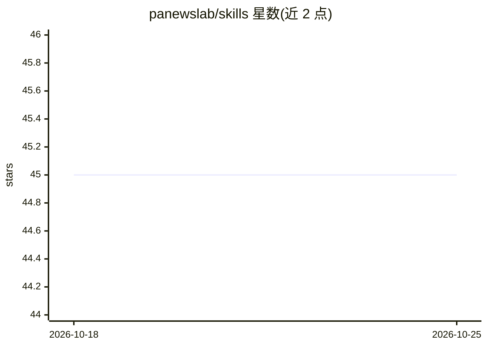

# panewslab/skills

⭐ 45 · JavaScript · MIT · 推送 2026-10-10 · [GitHub](https://github.com/panewslab/skills) · 组织维护

**面向 AI 助手的加密新闻与创作技能包（PANews 官方）**

PANews 官方发布的 agent 技能/插件包，提供三个技能：加密与区块链新闻检索及 Polymarket 聪明钱榜单读取（panews）、带会话鉴权的 PANews 创作者写作/发布工具（panews-creator，需 PA-User-Session）、将 PANews 页面读取为 Markdown 的网页查看器（panews-web-viewer）。仓库本身即为 Codex 与 Claude Code 风格插件根，含各自的 plugin.json 清单，另通过兼容布局支持 OpenClaw；文章内容以 Markdown 交换，Node 打包含运行时依赖。

## 筛选速览

| 维度 | 判定 | 备注 |
|---|---|---|
| AI 角色 | `ai-ecosystem` | LLM/agent 周边工具 |
| 许可风险 | `permissive` | MIT |
| 部署形态 | `library` | 以包/库形式分发 |
| 模型依赖 | — | README 未给出锁定关系 |
| 硬件要求 | — | 无带数字的原话,不猜 |
| 安装摩擦 | `low` | 无编译、无系统依赖或容器化 |
| 成熟度 | — | 结构信号不足 |

## 能力要点

- 三个技能：新闻发现、创作者工作流、网页转 Markdown
- 仓库即插件根，含 Codex 与 Claude Code 插件清单
- 通过 bunx/npx skills add 或本地 checkout 安装
- 事件列表支持 --limit/--cursor 分页并返回 nextCursor

## 适用场景

- 让 Claude Code 或 Codex 助手查询加密新闻与聪明钱榜单
- 经 AI 助手完成 PANews 文章写作、草稿与发布流程
- 将 PANews 页面内容转为 Markdown 供 agent 使用

## 场景标签

`网页抓取` · 领域:效率与自动化

## 证据(README 行号)

> L3: PANews Agent Toolkit is PANews's official agent package for cryptocurrency and blockchain news discovery, Polymarket
> L27: This repository itself is also the plugin root for Codex- and Claude Code-style plugin packaging. No extra wrapper 
> L31: - Codex: .codex-plugin/plugin.json

## 星数曲线

2026-10-18 45 → 2026-10-25 45（+0）

---
*卡片 v1 · prompt 1.4 · 生成 2026-10-25 · 置信度 high · 依据 README sha `89749446bdb3` · [字段定义](../../DATASET.md)*
