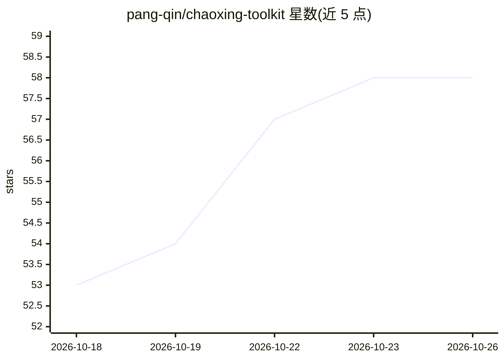

# pang-qin/chaoxing-toolkit

⭐ 58 · JavaScript · 推送 2026-06-01 · [GitHub](https://github.com/pang-qin/chaoxing-toolkit) · 个人维护 · 中文 README

**超星学习通自动刷课工具：自动答题与视频静音播放**

基于 Tampermonkey 用户脚本的学习通自动化工具，功能包括任务点自动跳转、视频/音频全自动静音播放、章节测验/作业/考试自动答题。答题有两种方式：一是配置 DeepSeek 等大模型 API Key 由脚本自动调用生成答案；二是自建基于 FastAPI + SQLite 的题库服务器精确匹配答案，附带题库管理后台（Vue 3 前端），未匹配题目可手动补充。README 声明仅供学习交流，平台反作弊更新可能导致失效。

## 筛选速览

| 维度 | 判定 | 备注 |
|---|---|---|
| AI 角色 | `ai-enhanced` | 去掉 AI 部分产品仍成立 |
| 许可风险 | `none` | — |
| 部署形态 | `library` | 以包/库形式分发 |
| 模型依赖 | — | README 未给出锁定关系 |
| 硬件要求 | — | 无带数字的原话,不猜 |
| 安装摩擦 | `low` | 无编译、无系统依赖或容器化 |
| 成熟度 | — | 结构信号不足 |

## 能力要点

- 任务点自动跳转与视频/音频全自动静音播放
- 接入 DeepSeek 等大模型 API 自动生成答案
- 自建 FastAPI 题库服务器精确匹配答案（8 种题型）
- 附带题库管理后台，支持导入/导出与待处理题目手动补充

## 适用场景

- 个人学生配置 AI API Key 后自动完成学习通课程任务
- 机构搭建题库服务器统一管理标准答案并批量答题
- 通过管理后台维护、导入题库并补充未匹配题目

## 场景标签

`浏览器自动化` · 领域:效率与自动化

## 证据(README 行号)

> L3: 超星学习通（Chaoxing）在线学习平台自动化工具，基于 超星学习通满分助手 改造，新增自定义题库服务器和 AI 解题功能，包含用户脚本和服务端题库 API 两部分。
> L8: - 新增 AI 解题功能，支持接入 DeepSeek 等大模型
> L22: - **个人学生**：直接使用 AI 解题即可，配置 DeepSeek 等 API Key 后脚本会自动调用大模型生成答案，无需额外部署。

## 星数曲线

2026-10-18 53 → 2026-10-26 58（+5）

---
*卡片 v1 · prompt 1.4 · 生成 2026-10-24 · 置信度 mid · 依据 README sha `5bce66f29df3` · [字段定义](../../DATASET.md)*
